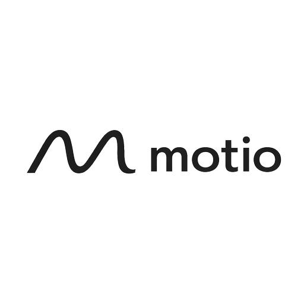
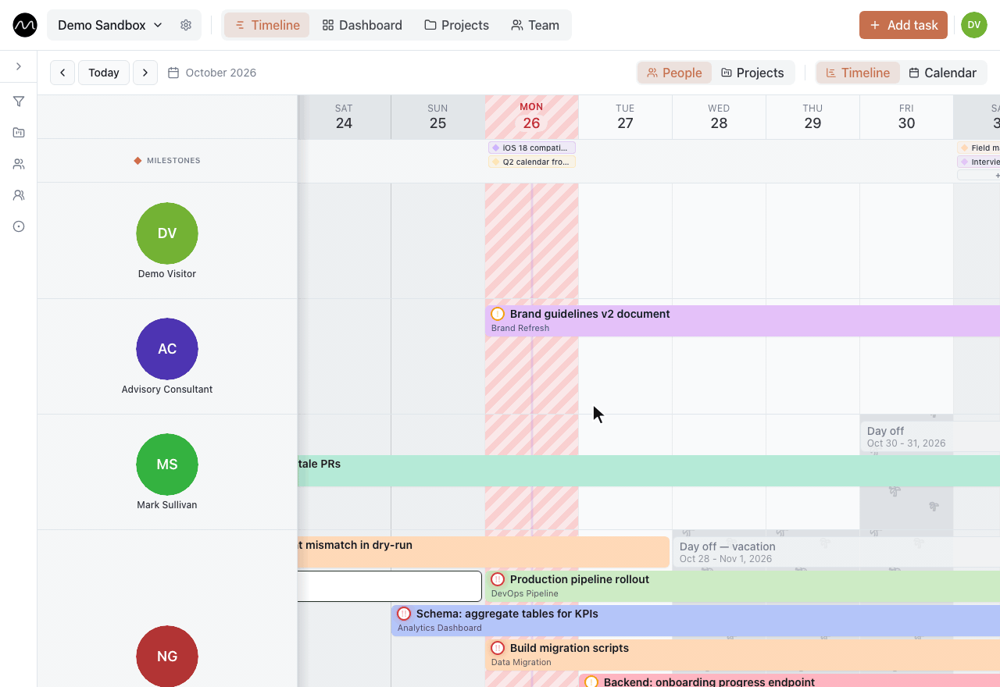
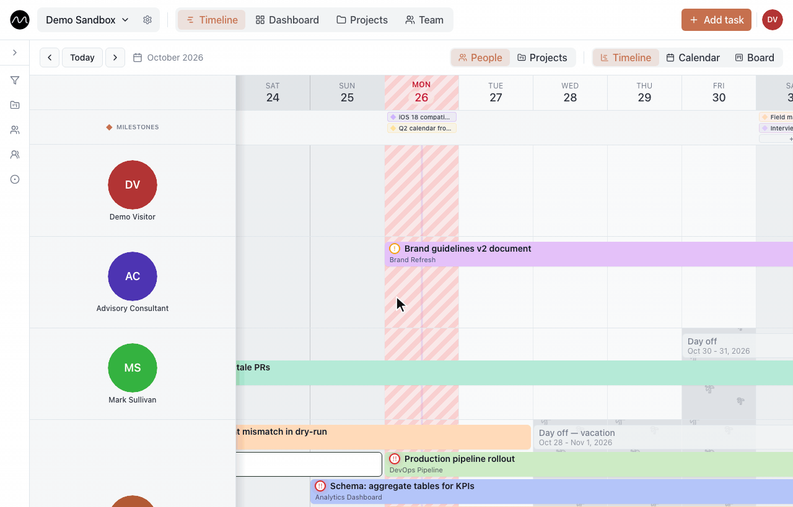

<div align="center">

<picture>
  <source media="(prefers-color-scheme: dark)" srcset=".github/assets/logo-dark-mode.png">
  
</picture>

# Motio

**See who's doing what this week — across every project.**

One shared timeline for your whole team: people, projects and workload on a single screen.
Free and open source: use the hosted app, or run it on your own servers. The live demo needs no sign-up.

**[▶ Try the live demo](https://motio.nikog.net/demo?utm_source=github&utm_medium=readme)** &nbsp;·&nbsp; **[Open Motio](https://motio.nikog.net/?utm_source=github&utm_medium=readme)** &nbsp;·&nbsp; **[Documentation](https://eleron96.github.io/motio/)** &nbsp;·&nbsp; [What's new](./CHANGELOG.en.md)

[](./CHANGELOG.en.md)
[](https://github.com/eleron96/motio/actions/workflows/ci.yml)
[](./LICENSE)
[](https://eleron96.github.io/motio/)

[](https://motio.nikog.net/demo?utm_source=github&utm_medium=readme&utm_content=gif)

<sub>Recorded in the live demo. Click it to try the same yourself — no sign-up.</sub>

</div>

## Why Motio

Most tools answer "what's in project X?". Motio answers the question a team lead asks on Monday: **who is busy, who is free, and where does the next task go?**

- 👥 **People first.** Every row is a person, every bar is their work — across all projects at once.
- 🔥 **Overload shows before the deadline.** Workload sits on the same timeline and in a department heatmap that knows who is on vacation.
- ⚡ **Any task in 10 seconds.** Click, type, drag. No custom fields, no automations — a position, not a gap ([manifesto](./MANIFESTO.md), in Russian).
- 🔓 **Yours to run.** AGPL-3.0. Use the free hosted app, or keep the data inside your own perimeter.

Built for teams of 5–50 people running several projects at once.

## What's inside

- 📅 **Timeline** by people or projects, day or week, a three-year calendar; milestones and time off on the same grid; ⌘K search, undo.
- ✅ **Tasks** with several assignees, subtasks with pictures, repeating series, comments with @mentions — live for the whole team.
- 📁 **Projects and customers**, 👥 **team and groups**, 📊 **dashboards** and a **workload heatmap**.
- 🗂 **Board (beta)** as an optional view next to the timeline.
- 📱 **Phones** with their own layout, 🔔 **push** (iPhone too), installable as an app.
- 🏢 **Workspaces and roles**, invitations with or without email, 🔐 **SSO** through Keycloak — on your own server also with your company's provider.
- 💾 **Backups** with one-click restore, 🗄 an **admin console**, 🌍 English, Russian and German.

Every screen, with screenshots, in the **[user guide](https://eleron96.github.io/motio/guide/)** ([по-русски](https://eleron96.github.io/motio/ru/guide/)).

<div align="center">

[](https://motio.nikog.net/demo?utm_source=github&utm_medium=readme&utm_content=board-gif)

<sub>The optional board, recorded in the live demo.</sub>

</div>

## Self-host

Most teams just [sign up](https://motio.nikog.net/?utm_source=github&utm_medium=readme). If your data has to stay inside your own perimeter, one command installs Motio on a Linux server with Docker:

```bash
git clone https://github.com/eleron96/motio.git && cd motio
git checkout vX.Y.Z   # latest release
infra/scripts/install.sh --domain planner.example.com --email you@example.com
```

Every update backs the install up first and can be rolled back; optional extras are switched on in the admin console. The install sends nothing to motio.nikog.net.

**📖 [The self-hosting guide](https://eleron96.github.io/motio/self-hosting/)** covers the rest — reverse proxy, your own sign-in, people and workspaces, settings, updates, backups, troubleshooting. Questions: [Discussions → Q&A](https://github.com/eleron96/motio/discussions/categories/q-a).

## Documentation

- **[User guide](https://eleron96.github.io/motio/guide/)** and **[self-hosting guide](https://eleron96.github.io/motio/self-hosting/)** — the website; the same pages live in [docs/guides/](docs/guides/README.md) and [docs/self-hosting/](docs/self-hosting/README.md).
- For developers and operators: [architecture](docs/architecture.md) · [configuration](docs/configuration.md) · [operations](docs/operations.md) · [troubleshooting](docs/troubleshooting.md) · [workspace API](docs/api.md).
- [Changelog](./CHANGELOG.en.md) ([на русском](./CHANGELOG.md)) · [manifesto](./MANIFESTO.md) · [instructions for AI assistants](./AGENTS.md).

## Contributing

Found a bug? [Open an issue](https://github.com/eleron96/motio/issues/new/choose). Questions and ideas: [Discussions](https://github.com/eleron96/motio/discussions). Local setup, checks and licensing of pull requests: [CONTRIBUTING.md](./CONTRIBUTING.md); everyone follows the [Code of Conduct](./CODE_OF_CONDUCT.md). Security problems — privately, see [SECURITY.md](./SECURITY.md).

## License

Motio is free software under the [GNU Affero General Public License v3.0](./LICENSE)
(`AGPL-3.0-only`). You can use it, run it for your team on your own servers, study it,
change it and share it. If you let other people use a modified version over a network,
you must offer them the source of that version under the same licence.

Copyright © 2026 Niko G.

The name "Motio" and the Motio logo are not covered by the licence: a fork, or a modified
version offered to others, needs a name and a logo of its own.

Need different terms — for example, to build Motio into a closed product? Write to
[inbox@nikog.net](mailto:inbox@nikog.net).
