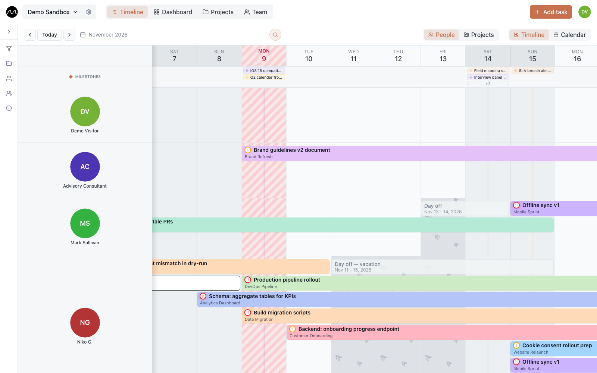

# Using Motio

Motio is a shared timeline for a team: one row per person, one bar per task, every
project in its own colour. It answers the question a team lead asks on Monday —
**who is busy, who is free, and where does the next task go?**

This guide shows where everything is and how it works. Everything in it can be tried
in the [live demo](https://motio.nikog.net/demo?utm_source=docs&utm_medium=guide&utm_campaign=overview):
no sign-up, and it resets on its own.

## The guide

**Start**
- [Getting started](./getting-started.md): signing up, your first workspace, what is where on the screen.
- [Motio on a phone](./phone.md): the same planner with gestures instead of a mouse.

**Plan**
- [The timeline](./timeline.md): views, adding and moving tasks, search, milestones, time off, filters.
- [Tasks](./tasks.md): the task card — assignees, subtasks, repeats, descriptions, comments.
- [The board](./board.md): the same tasks as cards in status columns.

**Team and projects**
- [Team](./team.md): people, groups and everyone's tasks.
- [Projects and customers](./projects.md): project cards, customers, contacts, milestones.
- [Dashboard and workload heatmap](./dashboard.md): charts and the team's load for the months ahead.

**Stay up to date**
- [Notifications](./notifications.md): the bell, push on computer and phone, the morning brief.

**Settings**
- [Workspace and roles](./workspaces.md): members, invitations, statuses and task types.
- [Your account](./account.md): profile, language, appearance, your data.

**Playbooks**
- [Your first week in Motio](./first-week.md): from an empty workspace to the team's real week.
- [Planning several projects with one team](./multiple-projects.md)
- [Spotting overload before it becomes a problem](./spotting-overload.md)

**Reference**
- [Keyboard shortcuts](./shortcuts.md)

## Where Motio runs

- **[motio.nikog.net](https://motio.nikog.net/?utm_source=docs&utm_medium=guide&utm_campaign=overview)**,
  free: sign up and start.
- **On your company's own server.** The planner is the same; a few things are switched
  on by the server's administrator. Setting it up is described in the
  [self-hosting guide](../self-hosting/).

Motio deliberately has no task dependencies, custom fields or automations: the hard part
of planning a team is seeing the work, not modelling it. Missing something anyway?
[Tell us](https://github.com/eleron96/motio/discussions/categories/ideas).
