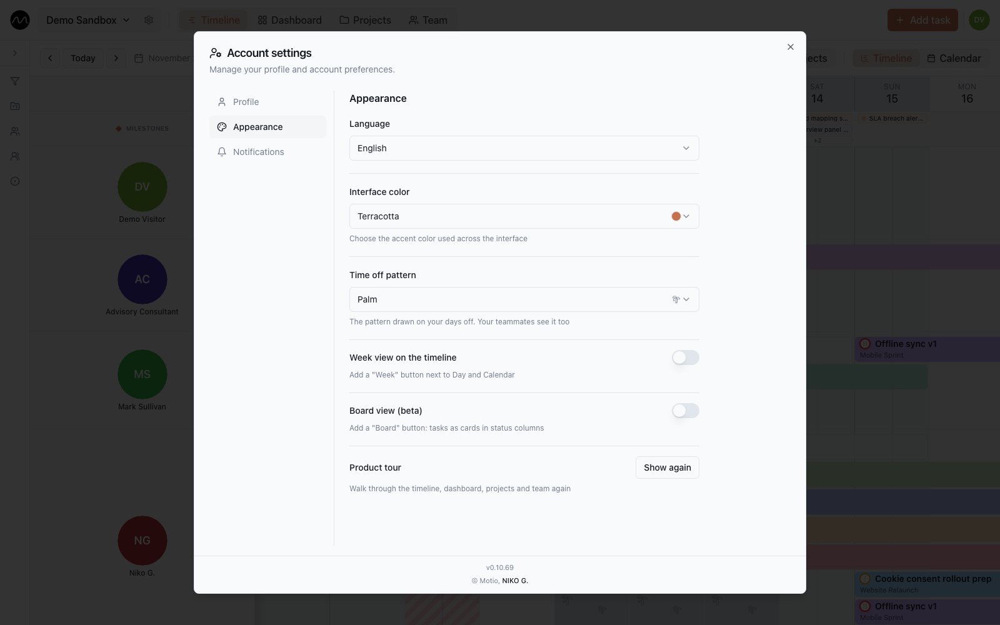

# Your account

Your avatar at the top right opens **Account settings**. What you set here is yours:
it follows you into every workspace and changes nothing for the others.

## Profile

Your name and photo, as your team sees them. Below them, a small summary: how long you
have been in Motio, the tasks you closed week by week over the last two months, and
which projects your tasks are in.

## Appearance

| Setting | |
|---|---|
| **Language** | English, Русский or Deutsch. The sign-in page, emails and push notifications follow it too. |
| **Interface color** | the accent colour of buttons and highlights |
| **Time off pattern** | the pattern drawn on your days off; your teammates see it too |
| **Week view on the timeline** | adds a **Week** scale next to **Day** and **Calendar** |
| **Board view (beta)** | adds the [board](./board.md) |
| **Product tour** | **Show again** replays the tour of the timeline |

## Notifications

- **Daily brief** — the [morning brief](./notifications.md#the-morning-brief).
- **Product news by email** — occasional announcements and tips.
- **Browser notifications** — [push](./notifications.md#push-notifications), and which
  events you want them for.

## Your data

**Data → Export my data** collects everything that is yours into one file: your profile,
your workspaces with their tasks, comments and history, and your notifications. It takes
a little while; a notification tells you when it is ready, and **Download export** gets
a ZIP with a JSON file inside. The file stays available for a day; after that, request a
new one.

## Deleting your account

**Danger zone → Delete my account** walks you through it:

1. **Workspaces you are the only admin of.** For each, choose who takes it over, or
   delete it. Workspaces with other admins you simply leave.
2. **Confirm** by typing the phrase shown.
3. **30 days to change your mind.** Signing in during that time offers
   **Restore my account**. After that, your data is anonymised for good; your name stays
   only on the comments you wrote.

## Help, sign out, and what's new

**Help** at the bottom of **Account settings** opens this guide. **Sign out** is in
**Account settings** too. At the bottom, the version number (such as *v0.10.69*) opens
**Latest changes**: what changed in Motio, version by version.

> [!NOTE]
> On a company server, the administrator decides whether **Data** and **Danger zone** are
> available.

## Next

- [Keyboard shortcuts](./shortcuts.md)
- [Workspace and roles](./workspaces.md)
