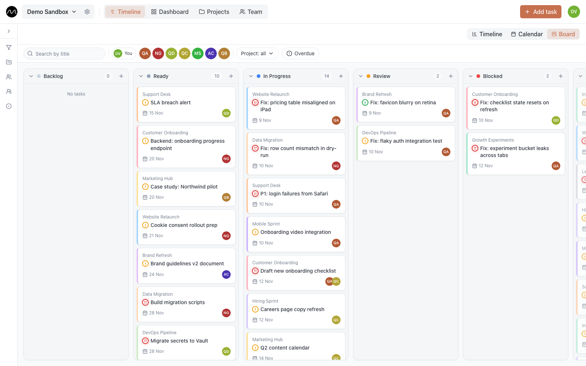

# The board

The board shows the same tasks as the timeline, as cards in columns by status. It is an
optional second view: handy for a stand-up or for working through what is open, while
the timeline stays the plan.

## Turn it on

The board is in beta, and each person turns it on for themselves:
**Account settings → Appearance → Board view (beta)**. A **Board** button then appears
next to **Timeline** and **Calendar**. On a company server the administrator has to
enable the board first; if the switch is missing, ask them.

## What it shows

- **Columns** are the workspace's statuses: open ones first, then the ones that count as
  done, then cancelled.
- **Open tasks** are all there, whatever their dates.
- **Done and cancelled tasks** stay for 14 days after their last change, then leave the
  board.
- **A repeating task** is one card per column, not one per repeat.

A card shows the project, the assignees, the end date (red when overdue), the priority,
the number of comments and a mark for repeating tasks. Click it to
[open the task](./tasks.md).

## Change a status

Drag a card to another column. Like on the timeline, **Undo** appears for a few seconds,
and **⌘Z** (**Ctrl+Z**) works too.

**+** at the top of a column creates a task that already has that status.

## Quick filters

Above the columns:

- **Search by title**
- **You** — only your tasks
- people, **Groups** and **Projects**
- **Overdue** — only tasks past their end date

**Reset** clears them. The board's filters are its own: they don't change the timeline,
and they reset when you leave the board.

## On a phone

One column per screen. Swipe between them, or tap a status in the tabs above. To change
a card's status, tap **⋯** on the card or hold it, and pick the new status.

## Next

- [Team](./team.md): people, groups and everyone's tasks.
