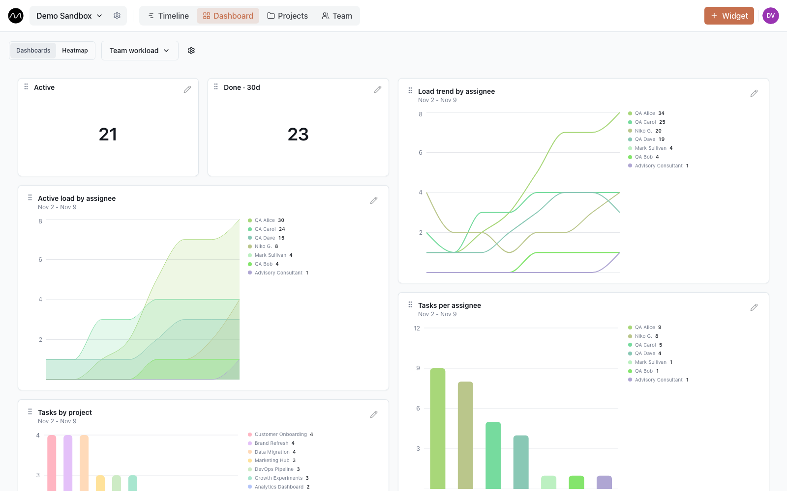
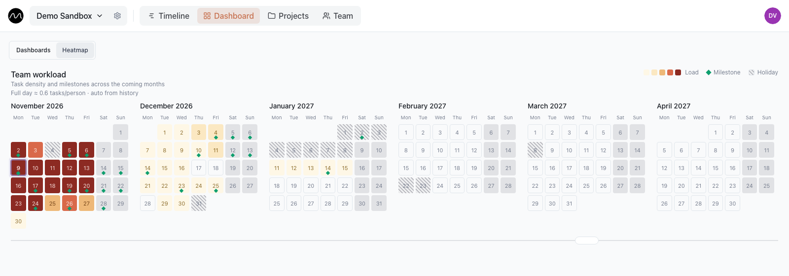

# Dashboard and workload heatmap

The timeline shows this week. **Dashboard** shows what it can't show at a glance: how the
load develops over weeks, and how heavy the months ahead are.

## Dashboards

A workspace can have up to ten dashboards, for example one for the team's load and one
for deliveries. Switch between them in the menu at the top left, where you also create,
rename and delete them. Everyone in the workspace sees the same dashboards.

## Widgets

Editors and admins add a widget with **Widget** at the top right (or by right-clicking an
empty dashboard), and change one with the pencil in its header or by right-clicking it.

| Type | Shows |
|---|---|
| **Text value** | one number: active tasks, tasks done in the last 30 days… |
| **Chart** | **Bar**, **Line**, **Area** or **Pie (Donut)**, grouped **by user**, **by project**, **by status** or **by task type**, over a **day**, **week** or **month** |
| **Milestones** | the coming milestones as a **List** or a **Calendar (month)** |

Each widget can be narrowed with filters — by person, project or status, and with
**Advanced filters**, groups of rules combined with AND or OR. Charts can use a palette, or
everyone's, every project's or every status's own colour.

Drag a widget by its header to move it, and by its bottom-right corner to resize it. On
a tablet or phone, hold the header first until moving switches on.

A first dashboard worth building: active tasks per person as a bar chart, each person's
load over time as a line chart, and a counter of tasks done in the last 30 days. A line
that keeps climbing for one person is overload in slow motion.

## Workload heatmap

**Dashboard → Heatmap** lays the coming months out as calendars. Each day is coloured from
pale (quiet) to dark red (over capacity); green diamonds are milestones, hatched days are
holidays.

How a day gets its colour:

- **Work per available person.** The day's tasks are divided among the people who are
  actually there. With two of six on vacation, the same work lands on four, and the day
  turns hotter.
- **Measured against your team's normal.** Motio works out what a full day means for
  *this* team from its recent history and shows it above the calendars, for example
  "Full day ≈ 0.8 tasks/person". An admin can set it by hand instead.
- **Deliveries take people.** A milestone ties up a small crew in the days before it:
  barely visible four days out, at its peak the day before. Milestones with
  **Counts toward department workload** unticked are left out.

Click a day to see its milestones and who is away, then **Open on timeline** to jump to
that date and move things around.

> [!NOTE]
> The heatmap is off by default and marked *experimental*. An admin turns it on in
> **Workspace settings → Display → Workload heatmap**; the manual "full working day" is
> set in the same place.

Two habits keep the picture honest: mark [time off](./timeline.md#time-off), and untick
**Counts toward department workload** for milestones that don't occupy anyone.

## Next

- [Spotting overload before it becomes a problem](./spotting-overload.md): a five-minute
  Monday check with the heatmap.
- [Notifications](./notifications.md)
