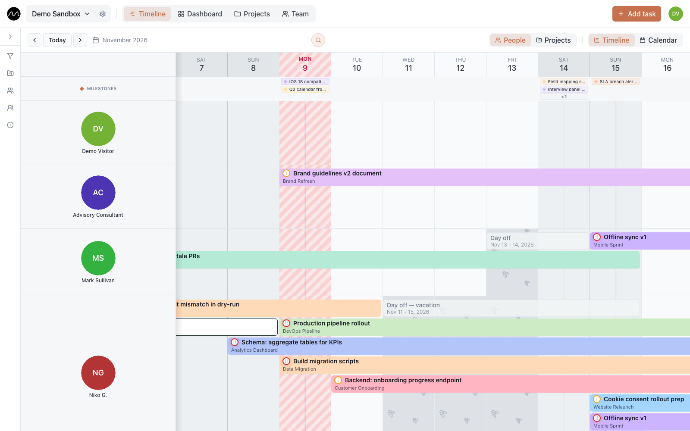

# Getting started

## Sign up

On [motio.nikog.net](https://motio.nikog.net/?utm_source=docs&utm_medium=guide&utm_campaign=getting_started)
choose **Start for free**. You need an email address and a password of at least 12
characters; a name is optional and can be added later. Forgot the password? The sign-in
page has **Forgot password?**.

On your company's own server, the sign-in page can also offer your company account
(Microsoft, Google Workspace, Authentik…). Which ones is up to the server's
administrator.

> [!TIP]
> Were you invited by email? Sign in, or sign up, with **that** address: the invitation
> waits for you in the notifications (the bell) and is accepted with one click. More in
> [Workspace and roles](./workspaces.md#joining-a-workspace).

## Your first workspace

A workspace is your team's shared space: its people, projects and tasks. The first time
you sign in, Motio creates one for you and asks **What does your team do?**

| Choice | You get |
|---|---|
| Architecture and design · BIM and project support · Construction and installation · Software development | statuses, task types and tags that fit the field, plus a few example tasks |
| Empty workspace | basic statuses and task types, no examples |
| My own set | the statuses, types and tags you once saved yourself (offered when you have saved one) |

Everything comes in the language of your interface. The examples are only there so the
screen isn't empty: **Remove examples** in the banner above the timeline clears them in
one go, and the statuses, types and tags stay. All of these can be changed later in
[workspace settings → Workflow](./workspaces.md#workflow).

A short **product tour** then shows the timeline: how to read it, how to add and move
tasks, milestones, and the other sections. Skip it whenever you like; it can be started
again from **Account settings → Appearance → Product tour → Show again**.

## What is where

| Where | What it does |
|---|---|
| **Workspace name** (top left) | switch to another workspace or create a new one |
| **⚙** next to it | [workspace settings](./workspaces.md): members, invitations, statuses, holidays |
| **Timeline · Dashboard · Projects · Team** | the four sections of Motio |
| **Add task** | a new task — or, in the same window, time off |
| **🔔** | [notifications](./notifications.md) and invitations |
| **Your avatar** (top right) | [account settings](./account.md): profile, language, appearance, notifications, sign out |
| **Funnel** on the left edge of the timeline | [filters](./timeline.md#filters): projects, people, groups, statuses, types, tags |

The four sections:

- **[Timeline](./timeline.md)** — the plan itself: who does what, and when. Most of the
  work happens here.
- **[Dashboard](./dashboard.md)** — charts of the team's load, and the workload heatmap.
- **[Projects](./projects.md)** — projects, customers and their contacts, milestones.
- **[Team](./team.md)** — people, groups, and each person's tasks.

## Who can do what

Every member of a workspace has a role:

- **Viewer** sees everything and changes nothing.
- **Editor** creates, changes and moves tasks, projects and milestones.
- **Admin** also manages members, invitations and the workspace settings.

Anyone, viewers included, can mark their own time off. Details in
[Workspace and roles](./workspaces.md#roles).

## Every morning

From your second day on, the first time you open Motio after 9:00 it greets you with a
**morning brief**: your overdue tasks, what is due today, and the milestones of the
coming week. It shows once a day and can be switched off in
**Account settings → Notifications → Daily brief**.

## Next

- [Your first week in Motio](./first-week.md): from an empty workspace to the team's real week.
- [The timeline](./timeline.md): everything you can do on the main screen.
