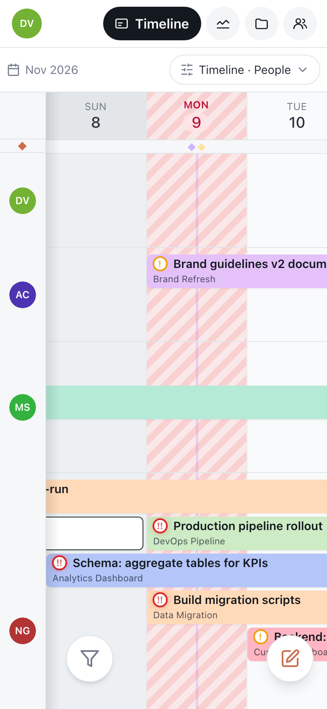

# Motio on a phone

Motio works in the phone's browser with a layout of its own: the same plan and the same
data, built for a thumb instead of a mouse. Everything you change shows up on everyone's
computer right away, and the other way round.

## Getting around

- **Sections** — **Timeline**, **Dashboard**, **Projects** and **Team** are at the top.
  Tap one, or swipe along the header to move between them.
- **Your avatar** at the top left opens the menu: notifications (the number on the
  avatar is the unread count), workspaces, workspace settings, account settings and
  **Help** — this guide.
- **The pencil button** at the bottom creates a task.
- **View** above the timeline switches between timeline, calendar and board, people and
  projects, day and week — all in one place.

Lists open as full screens, and panels that slide up from the bottom close with a swipe
down.

## Gestures on the timeline

| Gesture | Does |
|---|---|
| **Tap** a task | a quick look at it without opening |
| **Double-tap** a task | opens it |
| **Hold** a task | quick actions: status, priority, project, duplicate, delete |
| **Double-tap** an empty day in a row | a new task for that person (or project) and day |
| **Swipe** | scrolls through days and people |

On the **Calendar**, tap a day to see what is on it: tasks, milestones, who is away,
holidays. From there **Open this day** jumps to it on the timeline, and
**Create milestone** adds one.

## Other screens

- **Board** — one column per screen; swipe between statuses, or tap one in the tabs.
  Change a card's status with **⋯** or by holding the card.
- **Dashboard** — widgets one under another; swipe between dashboards and the heatmap.
  On the heatmap, tap a day for its details.
- **Task** — the card opens full screen; each field opens its own list.

## Install it like an app

Add Motio to the Home Screen and it opens without the browser's bars, with its own icon
and push notifications — on iPhone too. How: [Notifications](./notifications.md#on-iphone-and-ipad).

Timeline search (**⌘K**) is the one thing made for a computer only.

## Next

- [Notifications](./notifications.md)
- [Keyboard shortcuts](./shortcuts.md)
