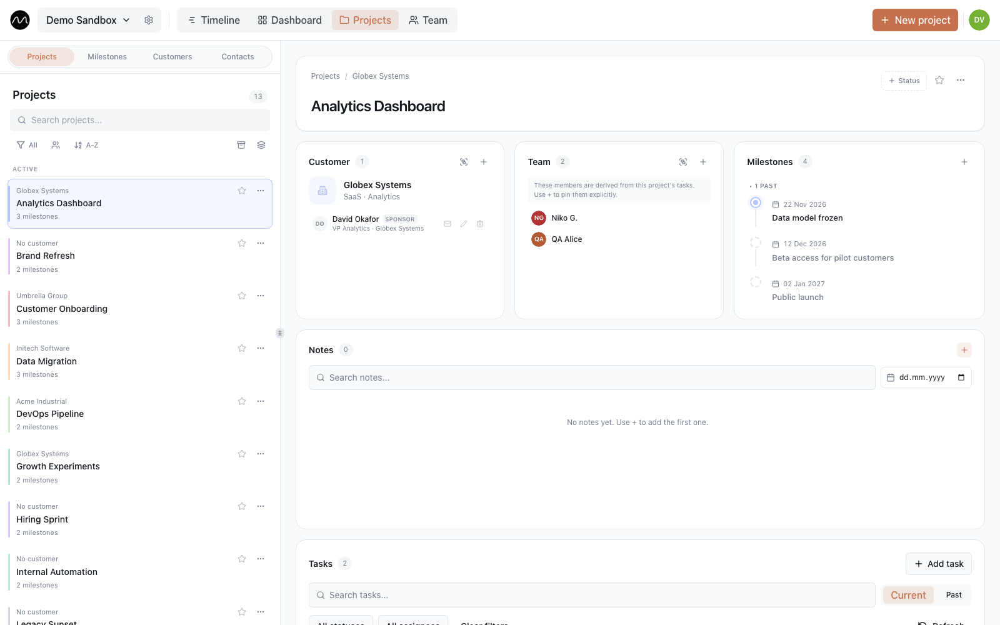

# Projects and customers

**Projects** in the top bar keeps everything around the work itself: projects, the
customers they are for, their contacts and milestones. Four tabs: **Projects**,
**Customers**, **Milestones** and **Contacts**. The button at the top right creates
whatever the tab holds — **New project**, **New customer**, **New milestone**,
**New contact**.

## Projects

A project is a stream of work you plan separately: a client job, an internal initiative,
a support rota. Every task belongs to one project and takes its colour on the timeline.

**New project** asks for:

| Field | |
|---|---|
| **Project name** | |
| **Code** | a short code shown with the name, e.g. `NW-12` |
| **Customer** | who it is for (optional) |
| **Color** | the colour of its tasks on the timeline |
| **Owner team** | the group responsible for it (optional) |

The list on the left can be searched, sorted, grouped by customer and filtered by
customer or owner team.

### The project card

Pick a project to open its card:

- **Status** — a free label next to the name, such as "In progress" or "On hold".
- **Customer** — the customer and their contacts. Click a contact for their email and
  phone, with buttons to copy them.
- **Team** — who works on it. People who have tasks in the project appear here on
  their own; **+** adds anyone else, from the workspace or from outside Motio, with their
  role and company.
- **Tasks** — the project's tasks, current or past, open or done, filterable by
  assignee. **Add task** creates one already in this project.
- **Milestones** — the project's milestones; **Hide past** keeps the list short.
- **Notes** — the project's log: decisions, agreements, pictures. Notes can be pinned to
  the top, searched and filtered by date.

### Track, archive, delete

From a project's **⋯** menu:

- **Track** — your own shortcut: tracked projects go to the top of every project list,
  in filters and in the task's **Project** field. Nobody else is affected.
- **Archive** — for finished projects. An archived project disappears from the timeline's
  **Projects** rows and from filters; its tasks stay. **Unarchive** brings it back;
  **Show archived** lists them.
- **Delete** — removes the project. Its tasks stay, just without a project.

## Customers

A customer groups projects: one customer can have several. Each has a name and an
optional industry or segment. Pick a customer to see their projects. Deleting a
customer keeps the projects, just without one.

## Milestones

All milestones of all projects in one list: **Current** or **Past**, searchable, groupable
and filterable by team. Pick one to see its details, or add one with **New milestone**.
On the timeline they sit in the [Milestones row](./timeline.md#milestones).

## Contacts

One directory of the people outside your team: customers' contacts and external project
members. Search it, or filter by company, tag or role. A contact on several projects is
listed once; editing them changes them everywhere they appear.

When you add a contact or a team member anywhere, Motio suggests people you have entered
before, so the same person isn't typed twice.

Editors and admins change projects, customers and contacts; viewers see them.

## Next

- [Dashboard and workload heatmap](./dashboard.md)
- [Planning several projects with one team](./multiple-projects.md)
