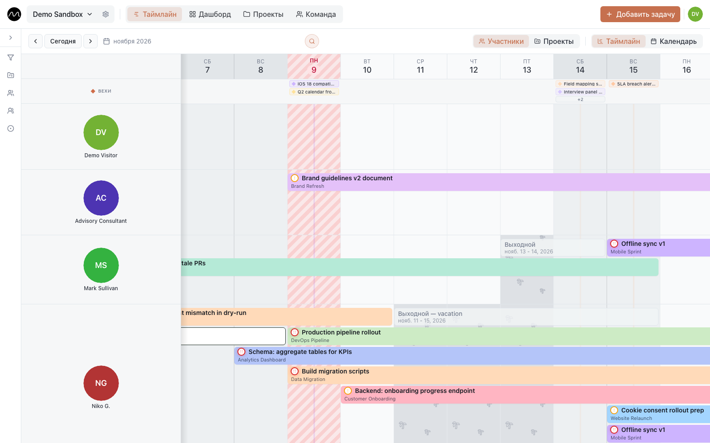

# Работа в Motio

Motio — общий таймлайн команды: строка — человек, полоска — задача, у каждого проекта
свой цвет. Он отвечает на вопрос, который руководитель задаёт в понедельник: **кто занят,
кто свободен и куда поставить следующую задачу?**

Эта инструкция показывает, что где находится и как работает. Всё из неё можно
попробовать в [демо](https://motio.nikog.net/demo?utm_source=docs&utm_medium=guide&utm_campaign=overview_ru):
без регистрации, и оно само сбрасывается. Интерфейс в демо — на вашем языке, а примеры
задач и проектов — на английском.

## Разделы

**Начало**
- [Начало работы](./getting-started.md): регистрация, первое пространство, что где на экране.
- [Motio на телефоне](./phone.md): тот же план, только жестами вместо мыши.

**Планирование**
- [Таймлайн](./timeline.md): виды, добавление и перенос задач, поиск, вехи, выходные, фильтры.
- [Задачи](./tasks.md): карточка задачи — исполнители, подзадачи, повторы, описание, комментарии.
- [Доска](./board.md): те же задачи карточками в колонках статусов.

**Команда и проекты**
- [Команда](./team.md): люди, группы и задачи каждого.
- [Проекты и клиенты](./projects.md): карточки проектов, клиенты, контакты, вехи.
- [Дашборд и тепловая карта](./dashboard.md): графики и нагрузка команды на месяцы вперёд.

**Быть в курсе**
- [Уведомления](./notifications.md): колокольчик, push на компьютере и телефоне, утренняя сводка.

**Настройки**
- [Пространство и роли](./workspaces.md): участники, приглашения, статусы и типы задач.
- [Ваш аккаунт](./account.md): профиль, язык, оформление, ваши данные.

**Сценарии**
- [Первая неделя в Motio](./first-week.md): от пустого пространства до реальной недели команды.
- [Несколько проектов, одна команда](./multiple-projects.md)
- [Как заметить перегрузку заранее](./spotting-overload.md)

**Справка**
- [Горячие клавиши](./shortcuts.md)

## Где работает Motio

- **[motio.nikog.net](https://motio.nikog.net/?utm_source=docs&utm_medium=guide&utm_campaign=overview_ru)** —
  бесплатно: зарегистрируйтесь и начинайте.
- **На сервере вашей компании.** Планировщик тот же; кое-что включает администратор
  сервера. Как его поставить, описано в
  [инструкции по своему серверу](../../self-hosting/) (на английском).

В Motio сознательно нет зависимостей между задачами, своих полей и автоматизаций:
в планировании команды трудно не описать работу, а увидеть её. Всё-таки чего-то не
хватает? [Расскажите нам](https://github.com/eleron96/motio/discussions/categories/ideas).
