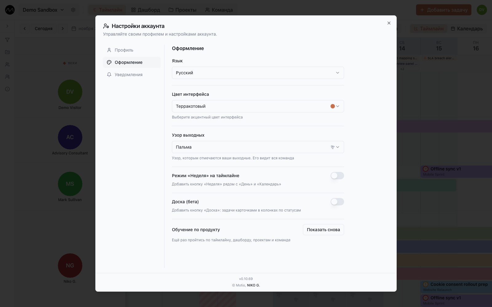

# Ваш аккаунт

Ваш аватар справа вверху открывает **Настройки аккаунта**. Всё, что здесь задано, —
ваше: действует во всех пространствах и ничего не меняет у других.

## Профиль

Ваши имя и фото — так вас видит команда. Под ними — небольшая сводка: сколько вы в
Motio, сколько задач закрывали по неделям за последние два месяца и в каких проектах
ваши задачи.

## Оформление

| Настройка | |
|---|---|
| **Язык** | English, Русский или Deutsch. На нём же страница входа, письма и push-уведомления. |
| **Цвет интерфейса** | цвет кнопок и выделений |
| **Узор выходных** | узор на ваших выходных днях; его видят и коллеги |
| **Режим «Неделя» на таймлайне** | добавляет масштаб **Неделя** рядом с **День** и **Календарь** |
| **Доска (бета)** | добавляет [доску](./board.md) |
| **Обучение по продукту** | **Показать снова** — пройти обучение по таймлайну ещё раз |

## Уведомления

- **Ежедневный дайджест** — [утренняя сводка](./notifications.md#утренняя-сводка).
- **Новости продукта на почту** — редкие новости и советы.
- **Уведомления в браузере** — [push](./notifications.md#push-уведомления) и о каких
  событиях их присылать.

## Ваши данные

**Данные → Экспортировать мои данные** собирает всё ваше в один файл: профиль, ваши
пространства с задачами, комментариями и историей, ваши уведомления. Это занимает
немного времени; когда файл готов, придёт уведомление, а **Скачать экспорт** даст
ZIP-архив с JSON-файлом внутри. Файл доступен сутки; потом запросите новый.

## Удаление аккаунта

**Опасная зона → Удалить мой аккаунт** проводит по шагам:

1. **Пространства, где вы единственный администратор.** Для каждого выберите, кто его
   примет, или удалите его. Из пространств, где есть другие администраторы, вы просто
   выйдете.
2. **Подтверждение** — введите показанную фразу.
3. **30 дней, чтобы передумать.** Если за это время войти, Motio предложит
   **Восстановить мой аккаунт**. Потом данные обезличиваются навсегда; ваше имя
   остаётся только у ваших старых комментариев.

## Выход и что нового

**Выйти** — тоже в **Настройках аккаунта**. Внизу номер версии (например, *v0.10.69*)
открывает **Последние изменения**: что менялось в Motio от версии к версии.

> [!NOTE]
> На сервере компании разделы **Данные** и **Опасная зона** включает администратор.

## Дальше

- [Горячие клавиши](./shortcuts.md)
- [Пространство и роли](./workspaces.md)
