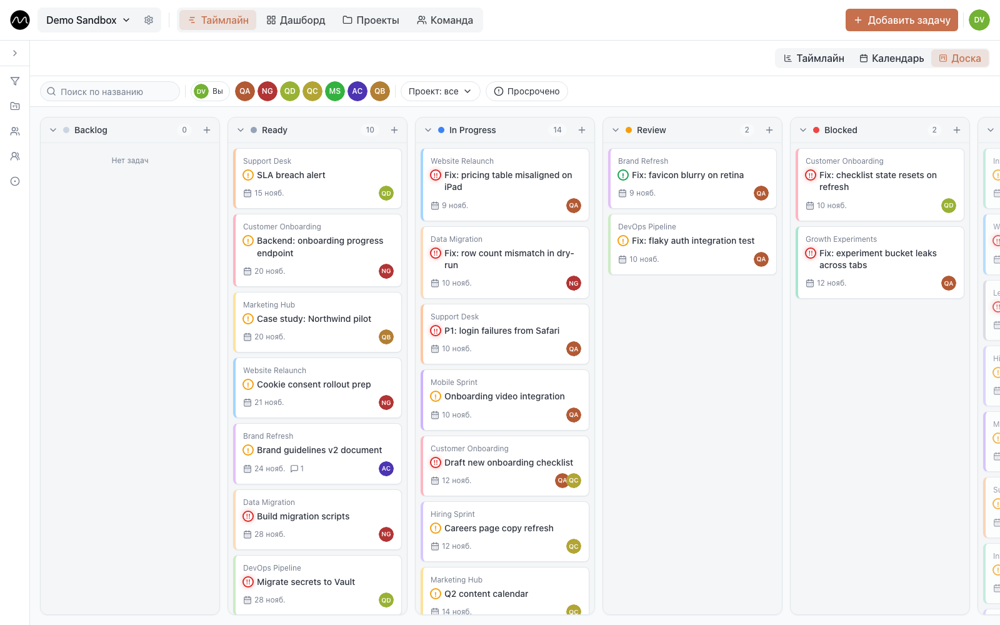

# Доска

Доска показывает те же задачи, что и таймлайн, — карточками в колонках по статусам.
Это необязательный второй вид: удобен на планёрке или чтобы разобрать всё открытое, а
план остаётся на таймлайне.

## Как включить

Доска в бете, и каждый включает её себе сам:
**Настройки аккаунта → Оформление → Доска (бета)**. Рядом с **Таймлайн** и **Календарь**
появится кнопка **Доска**. На сервере компании доску сначала должен включить
администратор; если переключателя нет — спросите его.

## Что на ней

- **Колонки** — статусы пространства: сначала открытые, потом те, что означают
  «выполнено», потом отменённые.
- **Открытые задачи** — все, какие бы у них ни были даты.
- **Выполненные и отменённые** остаются 14 дней после последнего изменения, потом уходят
  с доски.
- **Повторяющаяся задача** — одна карточка на колонку, а не по карточке на повтор.

На карточке — проект, исполнители, дата окончания (красная, если просрочена), приоритет,
число комментариев и значок повтора. Щёлкните по ней, чтобы [открыть задачу](./tasks.md).

## Поменять статус

Перетащите карточку в другую колонку. Как и на таймлайне, на несколько секунд появится
**Отменить**, и работает **⌘Z** (**Ctrl+Z**).

**+** вверху колонки создаёт задачу сразу с этим статусом.

## Быстрые фильтры

Над колонками:

- **Поиск по названию**
- **Вы** — только ваши задачи
- люди, **Группы** и **Проекты**
- **Просрочено** — только задачи, у которых прошла дата окончания

**Сброс** снимает их. Фильтры доски — свои: таймлайн они не меняют и сбрасываются, когда
вы уходите с доски.

## На телефоне

Одна колонка на экран. Листайте между ними или нажмите статус во вкладках сверху. Чтобы
поменять статус карточки, нажмите **⋯** на ней или подержите её и выберите новый статус.

## Дальше

- [Команда](./team.md): люди, группы и задачи каждого.
