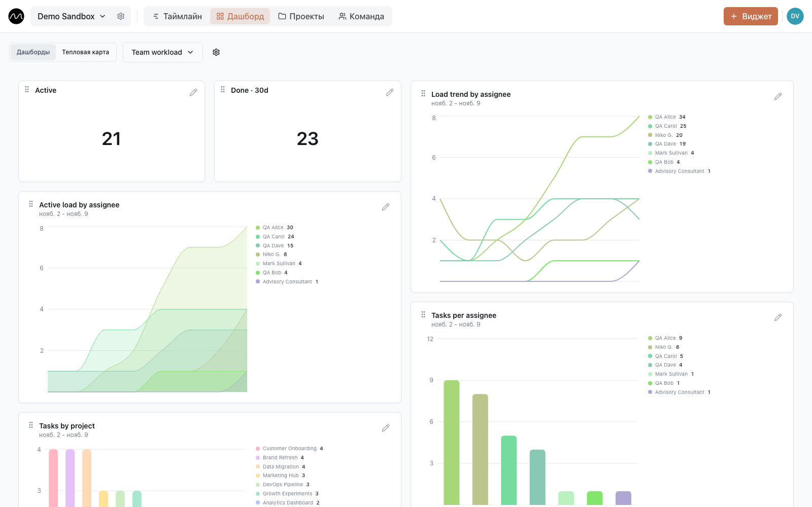
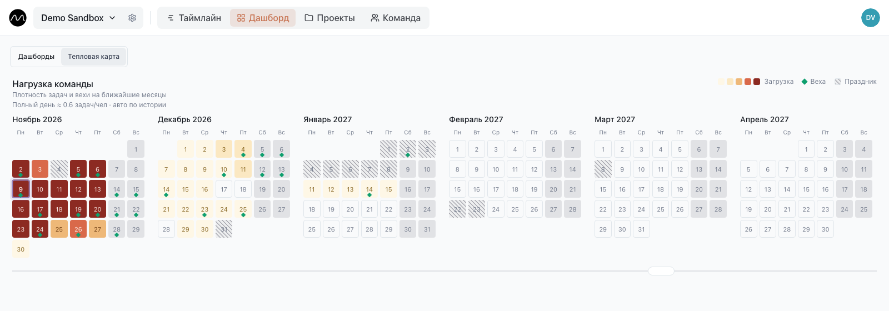

# Дашборд и тепловая карта

Таймлайн показывает эту неделю. **Дашборд** показывает то, что на нём не видно с одного
взгляда: как нагрузка меняется неделями и насколько тяжёлыми будут ближайшие месяцы.

## Дашборды

В пространстве может быть до десяти дашбордов — например, один про нагрузку команды,
другой про сдачи. Переключайтесь между ними в меню слева вверху, там же их создают,
переименовывают и удаляют. Дашборды у всех участников пространства общие.

## Виджеты

Редакторы и администраторы добавляют виджет кнопкой **Виджет** справа вверху (или правым
щелчком по пустому дашборду) и меняют его карандашом в шапке виджета или правым
щелчком по нему.

| Тип | Что показывает |
|---|---|
| **Текстовое значение** | одно число: активные задачи, выполненные за 30 дней… |
| **График** | **столбчатая**, **линейная**, **площадная** или **круговая (пончик)** диаграмма — **по пользователю**, **по проекту**, **по статусу** или **по типам задач**, за **день**, **неделю** или **месяц** |
| **Вехи** | ближайшие вехи **списком** или **календарём (месяц)** |

Каждый виджет можно сузить фильтрами — по людям, проектам или статусам, а в
**Расширенных фильтрах** — группами правил через И или ИЛИ. Графики рисуются палитрой
или собственными цветами людей, проектов или статусов.

Виджет переносится за шапку, а размер меняется за правый нижний угол. На планшете или
телефоне сначала подержите шапку, пока не включится перенос.

С чего начать: активные задачи по людям — столбчатой диаграммой, нагрузка каждого во
времени — линейным графиком и счётчик задач, выполненных за 30 дней. Линия, которая у
одного человека всё растёт и растёт, — это перегрузка в замедленной съёмке.

## Тепловая карта загрузки

**Дашборд → Тепловая карта** раскладывает ближайшие месяцы календарями. Каждый день
окрашен от бледного (спокойно) до тёмно-красного (сверх возможностей); зелёные ромбы —
вехи, заштрихованные дни — праздники.

Как день получает свой цвет:

- **Работа на человека, который на месте.** Задачи дня делятся на тех, кто действительно
  работает. Если двое из шести в отпуске, та же работа ложится на четверых, и день
  становится горячее.
- **По меркам вашей команды.** Motio сам вычисляет, что значит «полный день» для *этой*
  команды, по её недавней истории и показывает над календарями, например
  «Полный день ≈ 0,8 задач/чел». Администратор может задать его вручную.
- **Сдачи занимают людей.** Веха нагружает небольшую группу людей в дни перед ней: за
  четыре дня почти незаметно, сильнее всего — накануне. Вехи со снятой галочкой
  **Влияет на загрузку отдела** не учитываются.

Щёлкните по дню — увидите его вехи и кто отсутствует, затем **Открыть на таймлайне**,
чтобы перейти к этой дате и что-то передвинуть.

> [!NOTE]
> Тепловая карта по умолчанию выключена и помечена как *экспериментальная*.
> Администратор включает её в **Настройки пространства → Отображение → Тепловая карта
> загрузки**; там же задаётся «полный рабочий день» вручную.

Чтобы картина была честной, отмечайте [выходные](./timeline.md#выходные) и снимайте
галочку **Влияет на загрузку отдела** у вех, которые никого не занимают.

## Дальше

- [Как заметить перегрузку заранее](./spotting-overload.md): пятиминутная проверка по
  понедельникам с тепловой картой.
- [Уведомления](./notifications.md)
