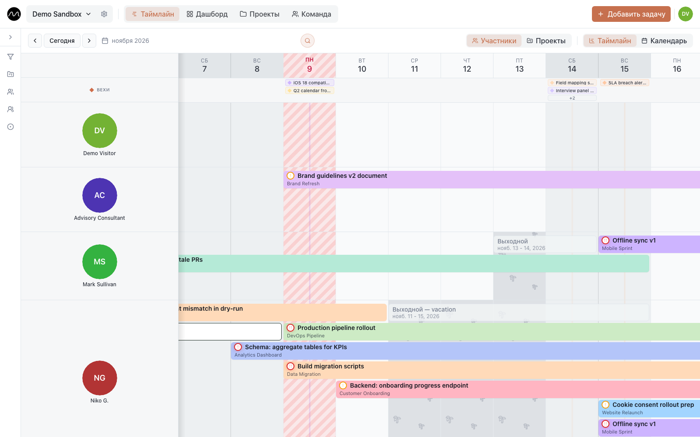

# Первая неделя в Motio

*Пять минут на настройку и одна настоящая неделя, чтобы понять, подходит ли вам общий таймлайн команды.*

Motio построен вокруг вопроса, который руководитель задаёт каждый понедельник: **кто
что делает на этой неделе и куда поставить следующую задачу?** Этот сценарий приводит к
ответу на настоящей работе вашей команды, а не на учебном проекте.

Повторяйте шаги в **[демо](https://motio.nikog.net/demo?utm_source=docs&utm_medium=guide&utm_campaign=first_week_ru)** —
без регистрации, сбрасывается само — или в своём пространстве на
[motio.nikog.net](https://motio.nikog.net/?utm_source=docs&utm_medium=guide&utm_campaign=first_week_ru).

## Понедельник: неделя на таймлайне

Новое пространство сначала спрашивает, чем занимается команда — архитектура и
проектирование, BIM и сопровождение проектов, строительство и монтаж, разработка ПО или
ничего из этого, — и создаёт подходящие статусы, типы задач и несколько примеров, чтобы
экран не был пустым. Осмотритесь с ними, потом нажмите **Убрать примеры** на плашке —
примеры исчезнут разом, а статусы и типы задач останутся.

Теперь добавьте работу, которая действительно есть на этой неделе:

1. **Двойной щелчок по дню в строке человека.** Форма задачи откроется сразу с этим
   человеком и этой датой. **Добавить задачу** справа вверху делает то же, только без
   подсказок.
2. Введите название и выберите проект. Растяните даты, если задача дольше одного дня.
3. Сохраните и переходите к следующей.

Цель — десять секунд на задачу. Черновой план из десяти настоящих задач полезнее
идеального из трёх. Если задача добавляется дольше, значит, что-то в Motio мешает —
[расскажите, что именно](https://github.com/eleron96/motio/issues/new/choose).

## Вторник: пригласите тех, кого планируете

Планировать в одиночку — это список дел; таймлайн окупается, когда вся команда видит
одну картину. Откройте настройки пространства — шестерёнка рядом с его названием, —
затем **Участники и доступ**, и пригласите коллег. Каждый получает роль:

- **Просмотр** — видит всё и ничего не меняет; для тех, кому нужно знать план;
- **Редактор** — создаёт и переносит задачи;
- **Администратор** — ещё управляет участниками и настройками пространства.

## Среда: меняйте план перетаскиванием

Планы меняются каждый день, и в Motio почти любое изменение — это перетаскивание, а не
форма:

- потяните полоску вбок — сдвинутся даты;
- потяните за край — задача станет короче или длиннее.

У края экрана таймлайн прокручивается следом, а если вы сдвинули что-то по ошибке, в
углу появится **Отменить**. Чтобы передать задачу другому, щёлкните по полоске и
поменяйте **Исполнители**. Изменение сразу видят все участники пространства, без
перезагрузки.

Внизу карточки задачи видно, кто её создал и кто последним менял поля, и когда.

Чтобы найти задачу на таймлайне с компьютера, нажмите лупу или **⌘K** (**Ctrl+K** в
Windows). Введите хотя бы два символа из названия задачи или подзадачи. Находятся и
задачи за пределами экрана; переходите между ними стрелками.

## Четверг: отметьте, кого не будет

План без отпусков — список желаний. Откройте **Добавить задачу**, переключитесь на
**Отметить выходной** и выберите дни. Свои выходные отмечает каждый, администраторы — за
любого. На таймлайне они видны серой полоской **Выходной**, так что никто случайно не
поставит работу на эти дни.

## Пятница: добавьте сроки, которые важны

Дважды щёлкните по дню в строке **Вехи** над таймлайном или щёлкните правой кнопкой по
дате в шапке и выберите **Создать веху**, затем привяжите её к проекту. Вехи стоят над
всеми строками, так что каждый видит, к чему идёт вся команда, а не только он сам.

Потом переключите строки на панели с **Участники** на **Проекты**: те же задачи, по
строке на проект. Так быстрее всего проверить, что у каждого проекта на следующей неделе
кто-то есть.

## Что отложить на потом

Статусы, типы задач, теги, повторы, группы, дашборды — всё это есть, когда понадобится, и
ничто из этого не нужно, чтобы ответить «кто что делает на этой неделе». Сначала
планируйте. Настраивайте потом — и только то, чего действительно не хватает.

## Дальше

- [Несколько проектов, одна команда](./multiple-projects.md)
- [Как заметить перегрузку заранее](./spotting-overload.md)
