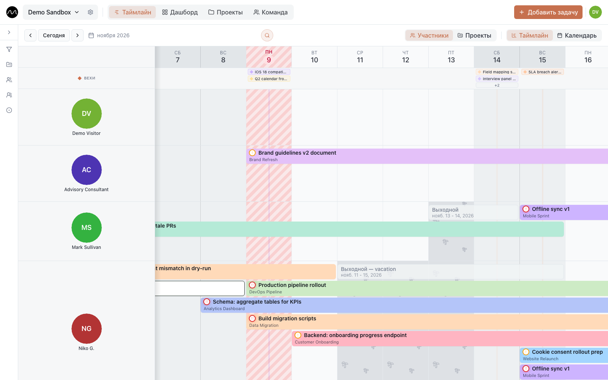

# Начало работы

## Регистрация

На [motio.nikog.net](https://motio.nikog.net/?utm_source=docs&utm_medium=guide&utm_campaign=getting_started_ru)
нажмите **Начать бесплатно**. Нужны почта и пароль не короче 12 символов; имя
необязательно, его можно добавить потом. Забыли пароль — на странице входа есть ссылка
для его сброса.

На сервере вашей компании страница входа может предлагать и корпоративную учётку
(Microsoft, Google Workspace, Authentik…). Какие именно — решает администратор сервера.

> [!TIP]
> Вас пригласили по почте? Войдите или зарегистрируйтесь **с этим адресом**: приглашение
> ждёт в уведомлениях (колокольчик) и принимается одной кнопкой. Подробнее —
> в разделе [Пространство и роли](./workspaces.md#как-попасть-в-пространство).

## Первое пространство

Пространство — общее место команды: её люди, проекты и задачи. При первом входе Motio
создаёт его сам и спрашивает: **Чем занимается ваша команда?**

| Вариант | Что получится |
|---|---|
| Архитектура и проектирование · BIM и сопровождение проектов · Строительство и монтаж · Разработка ПО | статусы, типы задач и теги под эту сферу и несколько задач-примеров |
| Пустое пространство | базовые статусы и типы задач, без примеров |
| Свой набор | статусы, типы и теги, которые вы когда-то сохранили сами (появляется, если сохраняли) |

Всё создаётся на языке интерфейса. Примеры нужны только для того, чтобы экран не был
пустым: кнопка **Убрать примеры** на плашке над таймлайном удаляет их разом, а статусы,
типы и теги остаются. Всё это можно поменять потом в
[настройках пространства → Процесс](./workspaces.md#процесс).

Затем короткое **обучение** показывает таймлайн: как его читать, как добавлять и
переносить задачи, вехи и остальные разделы. Его можно пропустить, а пройти заново —
**Настройки аккаунта → Оформление → Обучение по продукту → Показать снова**.

## Что где на экране

| Где | Что делает |
|---|---|
| **Название пространства** (слева вверху) | переключиться на другое пространство или создать новое |
| **⚙** рядом с ним | [настройки пространства](./workspaces.md): участники, приглашения, статусы, праздники |
| **Таймлайн · Дашборд · Проекты · Команда** | четыре раздела Motio |
| **Добавить задачу** | новая задача — или, в том же окне, выходной |
| **🔔** | [уведомления](./notifications.md) и приглашения |
| **Ваш аватар** (справа вверху) | [настройки аккаунта](./account.md): профиль, язык, оформление, уведомления, выход |
| **Воронка** у левого края таймлайна | [фильтры](./timeline.md#фильтры): проекты, люди, группы, статусы, типы, теги |

Четыре раздела:

- **[Таймлайн](./timeline.md)** — сам план: кто что делает и когда. Почти вся работа идёт
  здесь.
- **[Дашборд](./dashboard.md)** — графики нагрузки команды и тепловая карта.
- **[Проекты](./projects.md)** — проекты, клиенты и их контакты, вехи.
- **[Команда](./team.md)** — люди, группы и задачи каждого.

## Кто что может

У каждого участника пространства есть роль:

- **Просмотр** — видит всё и ничего не меняет.
- **Редактор** — создаёт, меняет и переносит задачи, проекты и вехи.
- **Администратор** — ещё управляет участниками, приглашениями и настройками
  пространства.

Свои выходные может отметить любой, в том числе с ролью «Просмотр». Подробнее —
в разделе [Пространство и роли](./workspaces.md#роли).

## Каждое утро

Со второго дня, когда вы впервые за день открываете Motio после 9:00, появляется
**утренняя сводка**: просроченные задачи, задачи на сегодня и вехи ближайшей недели.
Она показывается раз в день и выключается в
**Настройки аккаунта → Уведомления → Ежедневный дайджест**.

## Дальше

- [Первая неделя в Motio](./first-week.md): от пустого пространства до реальной недели команды.
- [Таймлайн](./timeline.md): всё, что можно делать на главном экране.
