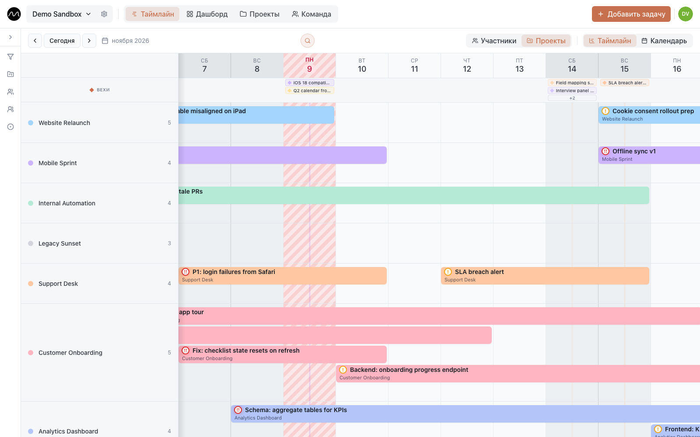

# Несколько проектов, одна команда

*Для команд, где одни и те же люди ведут сразу несколько проектов — клиентских или внутренних.*

Обычно несколько проектов планируют так: по доске или вкладке таблицы на проект. Каждая
по отдельности выглядит нормально. Проблемы начинаются, когда одни и те же четыре
человека есть во всех, и никто не замечает, что один из них в среду занят трижды.

Motio переворачивает это. Главная ось таймлайна — **люди**, а проекты — цвет их работы.
Всё ниже можно попробовать в
**[демо](https://motio.nikog.net/demo?utm_source=docs&utm_medium=guide&utm_campaign=multi_project_ru)**.

## Один раз заведите проекты

Откройте **Проекты** в верхней панели и создайте проект на каждое направление, которое
планируете отдельно: заказ клиента, внутреннюю инициативу, дежурства поддержки. Дайте
каждому цвет, который узнаётся с одного взгляда, — каждая полоска на таймлайне берёт цвет
своего проекта.

Если вы работаете на клиентов, заведите и клиента. У одного клиента может быть несколько
проектов, а карточка проекта держит в одном месте его задачи, команду, контакты клиента и
заметки.

## Планируйте в «Участниках», проверяйте в «Проектах»

Панель над таймлайном переключает две группировки одних и тех же задач:

- **Участники** — строка на человека, полоски в цвете проектов. Здесь планируют: сразу
  видно, что у кого-то на этой неделе уже идут два проекта.
- **Проекты** — строка на проект. Здесь проверяют: что происходит в каждом проекте и кто
  на нём.

Рабочий ритм: планировать в **Участниках**, а перед созвоном с клиентом переключиться на
**Проекты** и проверить, что ничего не забыто.

## Куда поставить следующую задачу?

Это ежедневный вопрос и причина, по которой Motio существует.

1. Оставайтесь в **Участниках** на текущей неделе.
2. Найдите строку с просветом в нужные дни — человека без полосок там.
3. Дважды щёлкните по просвету. Форма откроется с этим человеком и датой; выберите
   проект, введите название, сохраните.

Если просвета ни у кого нет — это тоже ответ: что-то надо сдвинуть, и лучше узнать об
этом в понедельник, чем в четверг. Перетащите менее срочную задачу на потом или
щёлкните по ней и передайте другому в поле **Исполнители**.

## Сузьте вид до того, что обсуждаете

Панель фильтров — воронка у левого края — оставляет на таймлайне выбранные проекты,
людей, группы, статусы или теги. С её помощью можно пройтись с клиентом только по его
проекту или посмотреть на один отдел.

Если команда делится на дисциплины или отделы, заведите их группами на странице
**Команда** кнопкой **Новая группа** — скажем, Дизайн и Разработка — и фильтруйте
таймлайн по ним.

## Держите в поле зрения сроки всех проектов

Веха принадлежит одному проекту, но видна над всеми строками. Каждый видит все ближайшие
сдачи, а не только своего проекта, — и как раз там обычно прячутся столкновения.
Страница **Проекты** собирает вехи всех проектов ещё и в одном списке.

## Еженедельная проверка за пятнадцать минут

- **Понедельник** — «Участники», текущая неделя: закройте просветы, разведите наложения.
- **В течение недели** — перетаскивайте то, что съехало, на новые даты; чтобы передать
  работу, откройте задачу и поменяйте **Исполнители**.
- **Пятница** — «Проекты», следующая неделя: у каждого проекта кто-то есть?

В Motio сознательно нет зависимостей между задачами, своих полей и автоматизаций. Когда
одни и те же люди тянут несколько проектов, трудно не описать работу, а увидеть её. Для
этого таймлайн и нужен.

## Дальше

- [Как заметить перегрузку заранее](./spotting-overload.md)
- [Первая неделя в Motio](./first-week.md)
