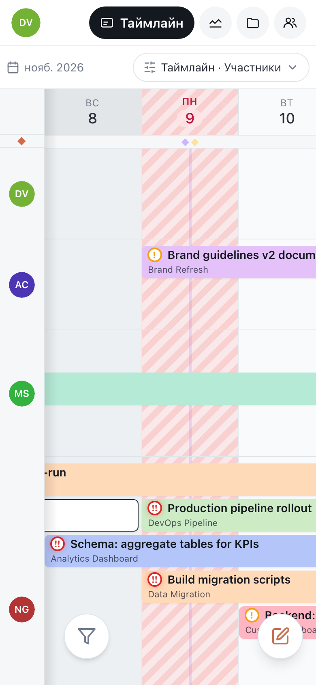

# Motio на телефоне

Motio работает в браузере телефона со своей раскладкой: тот же план и те же данные,
только под палец, а не под мышь. Всё, что вы меняете, сразу видно на компьютерах
коллег, и наоборот.

## Как перемещаться

- **Разделы** — **Таймлайн**, **Дашборд**, **Проекты** и **Команда** — сверху. Нажмите
  нужный или проведите пальцем по шапке, чтобы перейти к соседнему.
- **Ваш аватар** слева вверху открывает меню: уведомления (число на аватаре — сколько
  непрочитанных), пространства, настройки пространства и аккаунта и **Справка** — эта
  инструкция.
- **Кнопка с карандашом** внизу создаёт задачу.
- **Вид** над таймлайном переключает таймлайн, календарь и доску, участников и проекты,
  день и неделю — всё в одном месте.

Списки открываются на весь экран, а панели, выезжающие снизу, закрываются смахиванием
вниз.

## Жесты

| Жест | Что делает |
|---|---|
| **Касание** задачи | быстрый взгляд на неё без открытия |
| **Двойное касание** задачи | открывает её |
| **Удержание** задачи | быстрые действия: статус, приоритет, проект, дублировать, удалить |
| **Двойное касание** пустого дня в строке | новая задача на этого человека (или проект) и день |
| **Смахивание** | прокрутка по дням и людям |

В **Календаре** нажмите на день, чтобы увидеть, что в нём: задачи, вехи, кто
отсутствует, праздники. Оттуда **Открыть этот день** переходит к нему на таймлайне, а
**Создать веху** добавляет веху.

## Другие экраны

- **Доска** — колонка на экран; листайте между статусами или нажмите нужный во вкладках.
  Статус карточки меняется через **⋯** или удержанием карточки.
- **Дашборд** — виджеты друг под другом; листайте между дашбордами и тепловой картой. На
  тепловой карте нажмите на день, чтобы увидеть подробности.
- **Задача** — карточка открывается на весь экран, каждое поле — своим списком.

## Установить как приложение

Добавьте Motio на экран «Домой» — он будет открываться без панелей браузера, со своим
значком и push-уведомлениями, в том числе на iPhone. Как это сделать —
в разделе [Уведомления](./notifications.md#на-iphone-и-ipad).

Только для компьютера — поиск по таймлайну (**⌘K**).

## Дальше

- [Уведомления](./notifications.md)
- [Горячие клавиши](./shortcuts.md)
