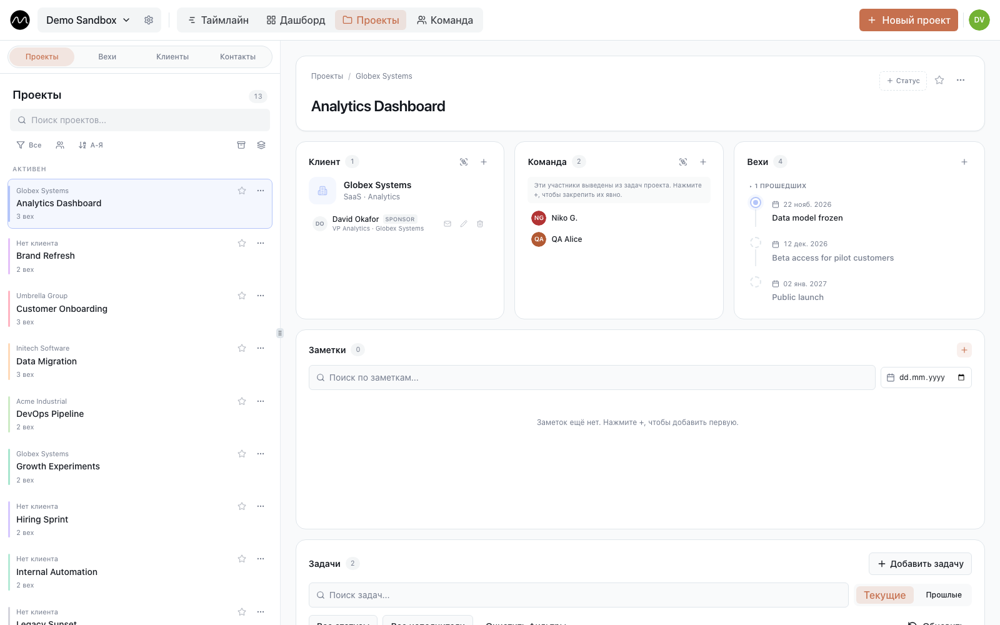

# Проекты и клиенты

**Проекты** в верхней панели — всё вокруг самой работы: проекты, клиенты, для которых они
делаются, их контакты и вехи. Четыре вкладки: **Проекты**, **Клиенты**, **Вехи** и
**Контакты**. Кнопка справа вверху создаёт то, что на вкладке: **Новый проект**,
**Новый клиент**, **Новая веха**, **Новый контакт**.

## Проекты

Проект — направление работы, которое вы планируете отдельно: заказ клиента, внутренняя
инициатива, дежурства поддержки. Каждая задача принадлежит одному проекту и на
таймлайне окрашена в его цвет.

**Новый проект** спрашивает:

| Поле | |
|---|---|
| **Название проекта** | |
| **Код** | короткий код рядом с названием, например `NW-12` |
| **Клиент** | для кого проект (необязательно) |
| **Цвет** | цвет его задач на таймлайне |
| **Команда-владелец** | группа, которая за него отвечает (необязательно) |

Список слева можно искать, сортировать, группировать по клиенту и фильтровать по
клиенту или команде-владельцу.

### Карточка проекта

Выберите проект — откроется его карточка:

- **Статус** — свободная подпись рядом с названием, например «В работе» или
  «Заморожен».
- **Клиент** — клиент и его контакты. Щёлкните по контакту — увидите почту и телефон с
  кнопками, чтобы их скопировать.
- **Команда** — кто работает над проектом. Люди с задачами в проекте появляются здесь
  сами; **+** добавляет кого угодно ещё — из пространства или вне Motio, с ролью и
  компанией.
- **Задачи** — задачи проекта: текущие или прошлые, открытые или выполненные, с фильтром
  по исполнителю. **Добавить задачу** создаёт задачу сразу в этом проекте.
- **Вехи** — вехи проекта; **Скрыть прошедшие** делает список короче.
- **Заметки** — журнал проекта: решения, договорённости, картинки. Заметки можно
  закрепить сверху, искать по ним и фильтровать по дате.

### Отслеживать, в архив, удалить

В меню проекта **⋯**:

- **Отслеживать** — ваш личный ярлык: отслеживаемые проекты стоят первыми во всех
  списках проектов — в фильтрах и в поле **Проект** у задачи. У остальных ничего не
  меняется.
- **Архивировать** — для завершённых проектов. Архивный проект пропадает из строк
  **Проекты** на таймлайне и из фильтров; его задачи остаются. **Разархивировать**
  возвращает его; **Показать архив** показывает архивные.
- **Удалить** — удаляет проект. Его задачи остаются, просто без проекта.

## Клиенты

Клиент объединяет проекты: у одного клиента их может быть несколько. У клиента есть
название и, если нужно, отрасль или сегмент. Выберите клиента — увидите его проекты.
Если удалить клиента, проекты останутся, просто без него.

## Вехи

Все вехи всех проектов одним списком: **Текущие** или **Прошлые**, с поиском,
группировкой и фильтром по команде. Выберите веху, чтобы увидеть подробности, или
добавьте новую кнопкой **Новая веха**. На таймлайне они стоят в
[строке «Вехи»](./timeline.md#вехи).

## Контакты

Единый справочник людей вне вашей команды: контакты клиентов и внешние участники
проектов. Ищите или фильтруйте по компании, тегу или роли. Человек, который есть в
нескольких проектах, показан один раз; правка его данных меняет их везде.

Когда вы где-то добавляете контакт или участника команды, Motio подсказывает уже
введённых людей, чтобы одного человека не вводили дважды.

Проекты, клиентов и контакты меняют редакторы и администраторы; с ролью «Просмотр» их
видно.

## Дальше

- [Дашборд и тепловая карта](./dashboard.md)
- [Несколько проектов, одна команда](./multiple-projects.md)
