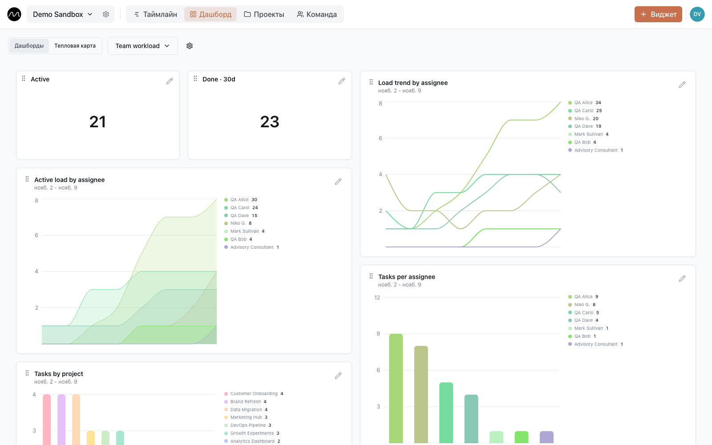
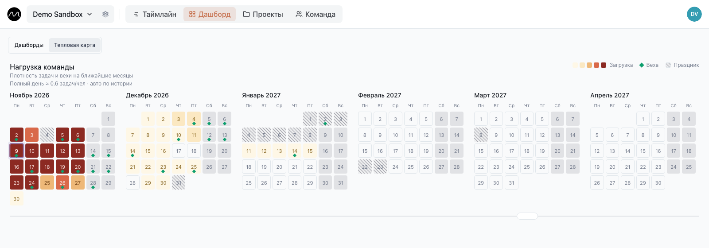

# Как заметить перегрузку заранее

*Как увидеть, что человек — или вся команда — вот-вот будет перегружен, пока ещё есть время что-то изменить.*

Перегрузка редко объявляет о себе. Она проявляется сорванным сроком, «доделаю ночью» в
чате или ретро, где все говорят, что спринт был «многовато». Перераспределять работу к
тому моменту уже поздно.

Motio показывает это раньше, на трёх дистанциях: эта неделя, последние несколько недель и
ближайшие месяцы. Каждую можно попробовать в
**[демо](https://motio.nikog.net/demo/dashboard?utm_source=docs&utm_medium=guide&utm_campaign=overload_ru)**.

## Эта неделя: читайте строки

В **Участниках** каждая строка — один человек, и задачи, которые пересекаются по датам,
складываются в его строке друг под другом. Пробегите строки в понедельник:

- **Строка в три полоски глубиной** — три дела сразу. Перегружен или вот-вот будет.
- **Пустой промежуток** — свободное время, естественное место для следующей задачи.
- **Серая полоска «Выходной»** — человека не будет; на него не рассчитывайте.

Исправляйте на месте: перетащите полоску на более поздние дни, растяните её на больше
дней или щёлкните по ней и передайте тому, у кого есть время, в поле **Исполнители**.

## Последние недели: дашборд

**Дашборд** показывает то, чего таймлайн не покажет с одного взгляда, — тренды. Редакторы
и администраторы добавляют виджеты кнопкой **Виджет**: счётчики и столбчатые, линейные,
площадные и круговые диаграммы, каждую можно отфильтровать по людям, проектам или
статусам.

Первый дашборд, который стоит собрать: активные задачи по людям — столбчатой диаграммой,
нагрузка каждого во времени — линейным графиком и счётчик задач, выполненных за 30 дней.
Линия, которая у одного человека всё растёт, — это перегрузка в замедленной съёмке.

## Ближайшие месяцы: тепловая карта загрузки

**Дашборд → Тепловая карта** раскладывает ближайшие месяцы календарями. Каждый день
окрашен от бледного (спокойно) до тёмно-красного (сверх возможностей); зелёные ромбы —
вехи, заштрихованные дни — праздники страны и вашего региона, если он выбран в
**Настройки пространства → Общие → Календарь праздников**.

Как день получает цвет, простыми словами:

- **Работа на человека, который на месте.** Задачи дня делятся на тех, кто действительно
  работает. Если двое из шести в отпуске, та же работа ложится на четверых, и день
  становится горячее.
- **По меркам вашей команды.** «Полный день» — полный именно для *этой* команды. Motio
  вычисляет его по вашей недавней истории и показывает над календарями — например,
  «Полный день ≈ 0,8 задач/чел». Администратор может задать его вручную.
- **Сдачи занимают людей.** Веха нагружает небольшую группу людей в дни перед ней: за
  четыре дня почти незаметно, сильнее всего — накануне. Несколько сдач в один день сильно
  бьют по маленькой команде — и это именно то, что хочется увидеть заранее.

Щёлкните по дню — увидите его вехи и сколько людей отсутствует, затем
**Открыть на таймлайне**, чтобы сразу перейти к этой дате и что-то передвинуть.

Две привычки делают картину честной:

- **Отмечайте выходные.** Ничто не меняет тепловую карту сильнее.
- **Не учитывайте вехи, которые никого не занимают** — дату договора, напоминание: снимите
  у такой вехи галочку **Влияет на загрузку отдела**.

### Как включить тепловую карту

Тепловая карта по умолчанию выключена и помечена как *экспериментальная*. Администратор
пространства включает её в настройках пространства — шестерёнка рядом с названием — в
разделе **Отображение** → **Тепловая карта загрузки**. Там же задаётся «полный рабочий
день» вручную.

Если карта врёт для вашей команды, [расскажите, как именно](https://github.com/eleron96/motio/discussions/categories/ideas).
Модель молодая, и настоящие команды делают её лучше.

## Проверка за пять минут по понедельникам

1. Откройте **Тепловую карту** и посмотрите на ближайшие два месяца: найдите самые тёмные
   дни.
2. Щёлкните по одному, затем **Открыть на таймлайне**.
3. Сдвиньте одну задачу или передайте её — до того, как кому-то придётся сказать
   «многовато».

## Дальше

- [Первая неделя в Motio](./first-week.md)
- [Несколько проектов, одна команда](./multiple-projects.md)
