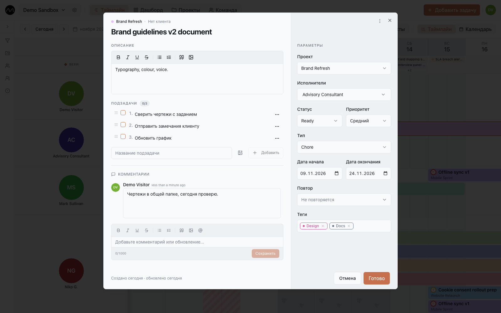

# Задачи

Щёлкните по полоске на таймлайне — откроется её задача. Та же карточка открывается с
доски, из поиска, из уведомления и из списков задач на страницах **Команда** и
**Проекты**.

Слева — название, описание, подзадачи и комментарии. Справа — **Параметры**. Внизу —
кто создал задачу и кто последним менял её поля, и когда.

Нажмите на строку **Изменено**, чтобы открыть **Историю изменений**: кто и когда
перенёс срок, сменил статус, проект или исполнителей, переименовал задачу или поправил
описание. Видны пять последних записей, остальные — по **Показать ещё**. Несколько
правок одного поля подряд одним человеком складываются в одну запись. В окне помещается
не больше 50 последних записей. История хранится
год (последняя запись задачи — дольше, пока есть задача) и ведётся с момента обновления Motio — более ранних правок в ней нет.

## Параметры

| Поле | Что значит |
|---|---|
| **Проект** | проект задачи; от него цвет полоски. Клиент проекта показан над названием. |
| **Исполнители** | один человек, несколько или никто (**Без назнач.**). Задача с несколькими исполнителями видна в строке каждого. |
| **Статус** | на какой стадии работа. Список — свой у каждого пространства; часть статусов означает «выполнено», один — «отменено». |
| **Приоритет** | высокий, средний, низкий или без приоритета |
| **Тип** | какая это работа: задача, встреча, проверка… Список тоже свой у пространства. |
| **Дата начала**, **Дата окончания** | дни, которые занимает задача. Окончание не может быть раньше начала. |
| **Повтор** | см. [Повторяющиеся задачи](#повторяющиеся-задачи) |
| **Теги** | свободные метки для фильтров |

Статусы, типы задач и теги настраивают редакторы и администраторы в
[настройках пространства → Процесс](./workspaces.md#процесс).

В меню **⋯** в шапке карточки — **Дублировать задачу** и **Удалить задачу**.

## Описание

Описание — форматированный текст: жирный, курсив, подчёркнутый, зачёркнутый, маркированные
и нумерованные списки, цитаты и картинки. Вставьте скриншот, перетащите файл картинки
или нажмите кнопку картинки (до 5 МБ на картинку). Текст, вставленный из других
программ, теряет их шрифты и цвета и выглядит как остальной Motio.

Щёлкните по картинке — она откроется во весь экран с увеличением.

Если кто-то поменял описание, пока вы писали своё, Motio ничего не перезаписывает: ваш
текст сохраняется, и вы выбираете — **Оставить моё** или **Взять их версию**.

## Подзадачи

Подзадачи — чек-лист внутри задачи.

- Введите подзадачу и нажмите **Enter**, чтобы добавить; **Shift+Enter** — новая строка в
  той же подзадаче.
- Набранная подзадача сохраняется сама, когда вы уходите из поля или закрываете
  карточку. **Esc** — отказаться от неё.
- Отметьте галочкой, когда сделано. Порядок меняется перетаскиванием за **≡**.
- К каждой подзадаче можно приложить до 10 картинок — удобно, чтобы отметить что-то на
  чертеже или скриншоте. Картинки можно добавлять ещё при создании задачи.

## Комментарии

Комментарии — разговор вокруг задачи.

- Наберите **@** и имя, чтобы упомянуть человека: ему придёт уведомление.
- Вставляйте картинки; комментарий может быть и просто картинкой.
- **⌘Enter** (**Ctrl+Enter** в Windows) отправляет комментарий.
- Свои комментарии можно изменить или удалить через их меню **⋯**; изменённый помечается
  *(изменено)*.

Закрываете карточку с неотправленным комментарием? Motio спросит, прежде чем его
выбросить. Читать комментарии могут все, писать — редакторы и администраторы.

## Работа вместе

Открытая карточка живая: подзадачи и комментарии коллег появляются, как только их
добавили. На компьютере видно и то, что коллега набирает прямо сейчас — подзадачу,
комментарий, описание, — полупрозрачно и с его именем. На motio.nikog.net это включено;
на сервере компании решает администратор.

## Повторяющиеся задачи

**Повтор** превращает задачу в серию: **Ежедневно**, **Еженедельно**, **Двухнедельная
(раз в две недели)**, **Каждые 4 недели**, **Ежемесячно** или **Ежегодно**. Затем
выберите, когда она заканчивается:

| Ограничение повтора | Значит |
|---|---|
| **Никогда** | повторы создаются на 12 месяцев вперёд |
| **Количество** | столько повторов, сколько вы укажете |
| **До даты** | повторы до этой даты |

Каждый повтор — отдельная задача на таймлайне. Когда вы меняете один из них, Motio
спрашивает, куда применить изменение:

- **Только эта задача** — только этот повтор; он выходит из серии.
- **Эта и последующие** — этот и все следующие.
- **Все задачи** — вся серия.

Удаление устроено так же: **Удалить текущую** или **Удалить текущую и следующие**;
прошлые повторы остаются всегда.

## Закрыть карточку

- **Готово** сохраняет изменения и закрывает карточку.
- **Отмена** закрывает её и возвращает изменения, которые вы сделали с момента открытия, —
  только ваши, не коллег.
- **Esc** или щелчок мимо тоже закрывают. Если название или описание ещё не сохранены
  или комментарий не отправлен, Motio сначала спросит.

## Дальше

- [Доска](./board.md): те же задачи по статусам.
- [Горячие клавиши](./shortcuts.md)
