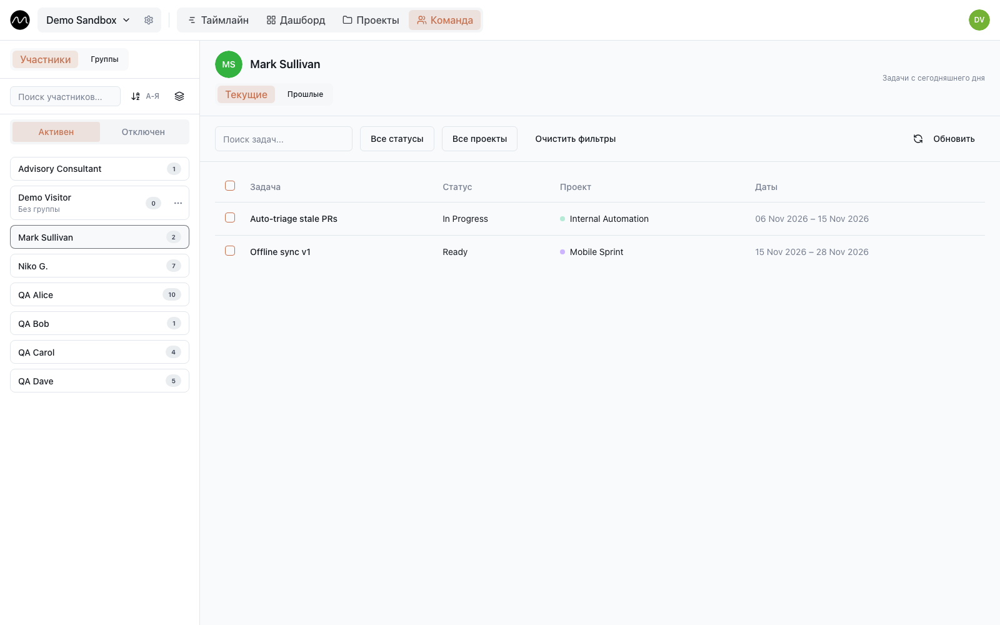

# Команда

**Команда** в верхней панели — список людей пространства и его групп, а ещё задачи
каждого человека в одном месте.

## Люди

В списке слева — все участники с ролью и группой. Ищите по имени, сортируйте от А до Я
или обратно, или включите **Группировать по группе**, чтобы видеть отделы вместе.
Те, кому администратор выключил доступ, — на вкладке **Отключен**; их задачи и
история остаются.

Выберите человека — справа его задачи:

- **Текущие** — задачи с сегодняшнего дня; **Прошлые** — более ранние, при желании за
  нужный период.
- Поиск по названию, фильтр по статусу или проекту, сортировка по дате начала, дате
  окончания или названию.
- Щёлкните по задаче — она откроется с подзадачами и комментариями.

Редакторы и администраторы могут отметить несколько задач и удалить их разом.

Приглашения, роли и доступ настраиваются в
[настройках пространства](./workspaces.md#участники-и-доступ), не здесь.

## Люди без аккаунта

Иногда человека нужно поставить на таймлайн раньше, чем он начнёт пользоваться Motio,
или вы планируете небольшую команду в одиночку. Если администратор вашего сервера Motio
включил эту возможность, администраторы пространства видят на странице «Команда» кнопку
**Добавить человека**: введите имя, при желании почту и телефон.

- У человека появляется строка на таймлайне, как у всех. Ему можно ставить задачи и
  отсутствия, и он учитывается в тепловой карте загрузки.
- Войти он не может и уведомлений не получает. В списке он отмечен **Без аккаунта**;
  та же пометка стоит рядом с именем в списке исполнителей задачи.
- **Редактировать**, **Отключить** и **Включить** — в меню человека. Отключённый
  переходит на вкладку **Отключен** вместе со своими задачами.
- Человека без аккаунта нельзя добавить в группу.

Когда человек готов подключиться, выберите в его меню **Пригласить в Motio** и укажите
почту и роль. После того как он примет приглашение, строка станет его — со всеми
задачами и отсутствиями, которые на ней уже есть: переносить ничего не нужно. Если
приглашение отменить, строка останется как была.

Так же можно вести то, что не является человеком: машину, переговорную, бригаду.
Добавьте строку **Газель 2**, ставьте её рейсы на таймлайн как задачи, а ремонт
отмечайте как отсутствие. Motio считает такую строку человеком, поэтому она тоже
учитывается в тепловой карте.

## Группы

Группы — это отделы или дисциплины: Дизайн, Разработка, Поддержка. Человек состоит в
одной группе. По группам можно фильтровать таймлайн и доску.

Администраторы управляют ими на вкладке **Группы**:

- **Новая группа** создаёт группу.
- **Добавить участника** добавляет людей в выбранную группу; **Перенести в другую
  группу** и **Удалить из группы** — в меню каждого человека.
- Группу можно переименовать или удалить. Люди при удалении группы остаются, просто без
  группы; их задачи не меняются.
- У каждой группы есть цвет — точка рядом с названием. Нажмите круглый образец перед
  названием открытой группы и выберите один из двадцати цветов; **Автоматический цвет**
  возвращает выбор Motio — он даст группе цвет, который не выбрала ни одна другая. На
  телефоне это пункт **Цвет** в меню группы. Той же точкой группа отмечена как
  команда-владелец в списке проектов.

## Цвета

У каждого человека есть цвет: за его инициалами, на графиках дашборда по людям и на
кружках его выходных в календаре. Свой цвет можно поменять в
**Настройки пространства → Участники и доступ → Цвета**; администраторы меняют любой.

## Дальше

- [Проекты и клиенты](./projects.md)
- [Пространство и роли](./workspaces.md)
