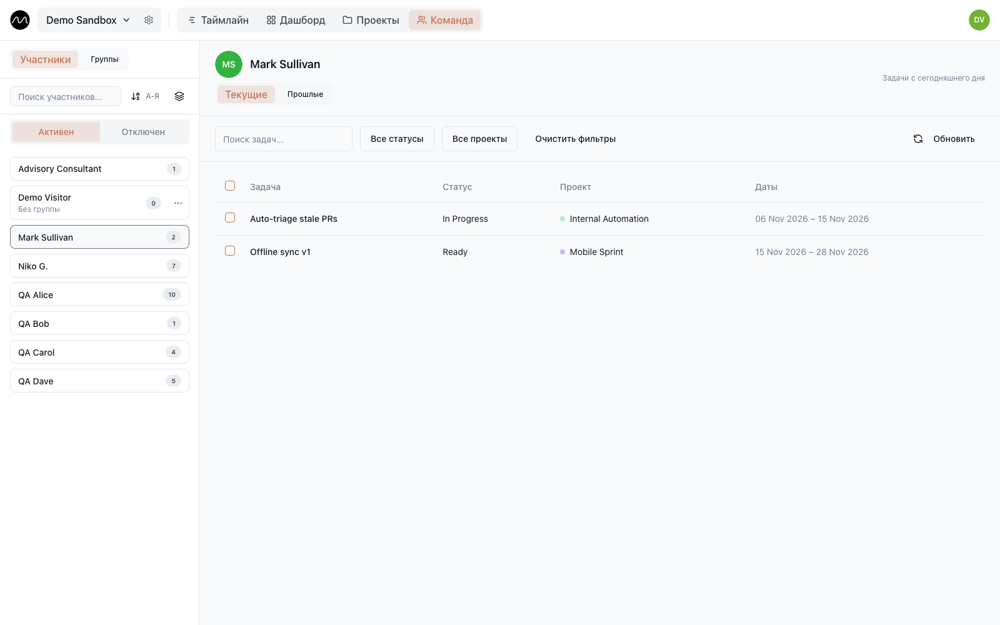

# Команда

**Команда** в верхней панели — список людей пространства и его групп, а ещё задачи
каждого человека в одном месте.

## Люди

В списке слева — все участники с ролью и группой. Ищите по имени, сортируйте от А до Я
или обратно, или включите **Группировать по группе**, чтобы видеть отделы вместе.
Те, кому администратор выключил доступ, — на вкладке **Отключен**; их задачи и
история остаются.

Выберите человека — справа его задачи:

- **Текущие** — задачи с сегодняшнего дня; **Прошлые** — более ранние, при желании за
  нужный период.
- Поиск по названию, фильтр по статусу или проекту, сортировка по дате начала, дате
  окончания или названию.
- Щёлкните по задаче — она откроется с подзадачами и комментариями.

Редакторы и администраторы могут отметить несколько задач и удалить их разом.

Приглашения, роли и доступ настраиваются в
[настройках пространства](./workspaces.md#участники-и-доступ), не здесь.

## Группы

Группы — это отделы или дисциплины: Дизайн, Разработка, Поддержка. Человек состоит в
одной группе. По группам можно фильтровать таймлайн и доску.

Администраторы управляют ими на вкладке **Группы**:

- **Новая группа** создаёт группу.
- **Добавить участника** добавляет людей в выбранную группу; **Перенести в другую
  группу** и **Удалить из группы** — в меню каждого человека.
- Группу можно переименовать или удалить. Люди при удалении группы остаются, просто без
  группы; их задачи не меняются.

## Цвета

У каждого человека есть цвет: за его инициалами, на графиках дашборда по людям и на
кружках его выходных в календаре. Свой цвет можно поменять в
**Настройки пространства → Участники и доступ → Цвета**; администраторы меняют любой.

## Дальше

- [Проекты и клиенты](./projects.md)
- [Пространство и роли](./workspaces.md)
