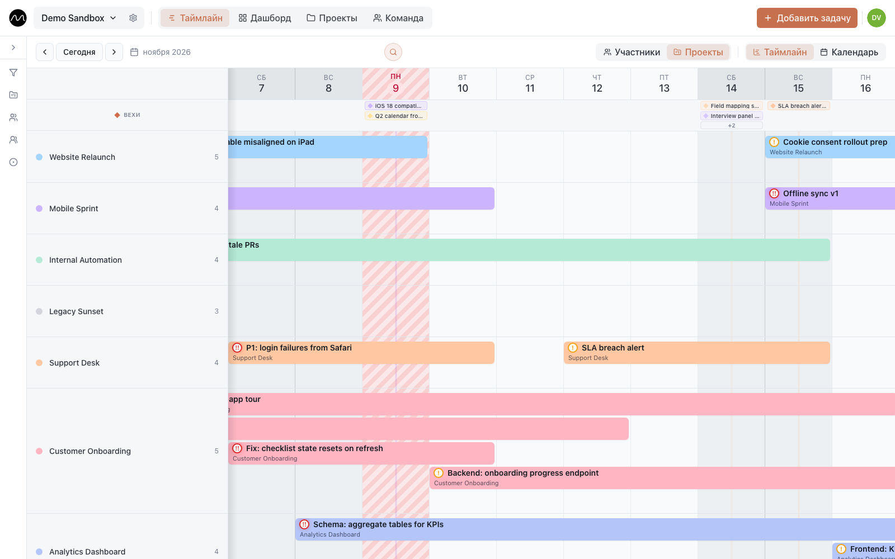
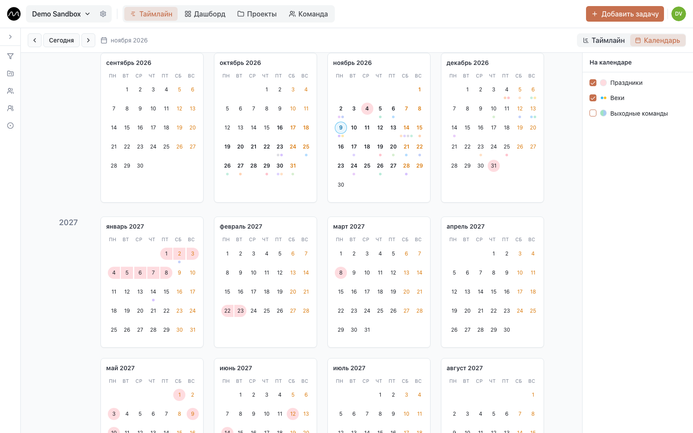

# Таймлайн

Таймлайн — главный экран Motio и сам план. Строка — человек (или проект), полоска —
задача, её цвет — цвет проекта. Столбец в красную полоску — сегодня.

## Как читать полоску

- **Цвет** — проект.
- **Эмодзи** в начале — статус задачи, если у статуса он есть.
- **!** зелёный или жёлтый, **‼** красный — низкий, средний или высокий приоритет.
- **Зачёркнутое название** — задача выполнена. **Бледная** — отменена.
- **Серая полоска «Выходной»** — человека нет на месте.

Задачи, которые пересекаются по датам, складываются в строке друг под другом: строка в
три полоски глубиной — это три дела сразу. Наведите на полоску — увидите проект,
исполнителей и повтор; щёлкните — [откроется задача](./tasks.md).

## Виды

Панель над таймлайном переключает, что вы видите:

| Переключатель | Варианты |
|---|---|
| **Вид** | **Таймлайн** · **Календарь** · **Доска** (когда [включена](./board.md)) |
| **Строки** | **Участники** — строка на человека · **Проекты** — строка на проект |
| **Масштаб** | **День** · **Неделя** (когда включена в **Настройки аккаунта → Оформление → Режим «Неделя» на таймлайне**) |

**Участники** — чтобы планировать: сразу видно, кто занят, а кто свободен.
**Проекты** — чтобы проверить: что происходит в каждом проекте и кто на нём.
Архивные проекты в строках **Проекты** не показываются.

По времени двигайтесь кнопками **Назад**, **Сегодня** и **Далее** или прокруткой вбок.
Щелчок по аватару в строке показывает крупное фото человека, имя и почту.

## Добавить задачу

- **Двойной щелчок по пустому месту в строке.** Форма задачи откроется сразу с этим
  человеком (или проектом) и этим днём. В каждой строке под задачами специально оставлено
  свободное место.
- **Правый щелчок** по дню в строке → **Создать задачу** — то же самое.
- **Добавить задачу** в верхней панели — пустая форма.

Введите название, проверьте проект и даты и сохраните. Остальное подождёт: про карточку
целиком — в разделе [Задачи](./tasks.md).

## Перенести и растянуть

- **Потяните полоску** вбок — сдвинутся даты.
- **Потяните за край** — задача станет длиннее или короче.

У края экрана таймлайн сам прокручивается следом. Перетаскивание меняет только даты:
чтобы передать задачу другому, откройте её и поменяйте **Исполнители**.

Изменение видят все участники пространства в течение секунды, без перезагрузки.

### Отмена

Сдвинули, растянули или удалили что-то по ошибке? В углу на несколько секунд появляется
**Отменить**, работает и **⌘Z** (**Ctrl+Z** в Windows) — до 20 последних шагов. Отмена
возвращает переносы и растягивания, статус, приоритет или проект, поменянные из меню
полоски или на доске, и удалённые задачи. Чужие более свежие правки она не перезаписывает.
Правки внутри карточки задачи так не отменяются.

## Меню полоски

Правый щелчок по полоске — быстрые правки без открытия задачи:

| Пункт | Что делает |
|---|---|
| **Статус** | ставит статус |
| **Приоритет** | высокий, средний, низкий или без приоритета |
| **Назначить проект** | переносит задачу в другой проект |
| **Дублировать задачу** | делает копию |
| **Удалить задачу** | удаляет её (у повторяющейся — только эту или эту и следующие) |

Если у задачи несколько исполнителей и вы в строках **Участники**, удаление из строки
одного человека предложит убрать из задачи только его.

## Поиск

На компьютере нажмите **⌘K** (**Ctrl+K** в Windows) или **/**, либо лупу на панели.
Введите хотя бы два символа из названия задачи или подзадачи.

- Подходящие полоски остаются яркими, остальные бледнеют.
- Лента сверху показывает совпадения на любых датах, а не только на экране. Переходите
  между ними стрелками **↑** и **↓** или щелчком; **Enter** открывает задачу.
- Если совпала подзадача, в превью видно её название, а открывается её задача.
- **Esc** закрывает поиск.

Поиск работает на компьютере, в масштабах **День** и **Неделя**.

## Вехи

Вехи — сроки, которые важны: сдача, запуск, проверка. Каждая принадлежит проекту и стоит
в строке **Вехи** над задачами всех, так что вся команда видит, к чему идёт.

- **Добавить:** двойной щелчок по дню в строке **Вехи** или двойной либо правый щелчок
  по дате в шапке → **Создать веху**.
- **Заполнить:** название, дату, проект и, если нужно, заметку.
- **Влияет на загрузку отдела** — оставьте галочку для сдач, которые занимают людей;
  снимите для даты договора или напоминания. Это важно для
  [тепловой карты](./dashboard.md#тепловая-карта-загрузки).

Щёлкните по вехе, чтобы изменить или удалить её. Когда их в день много, **+N** покажет
остальные. Все вехи всех проектов собраны ещё и в **Проекты → Вехи**.

## Выходные

План, который не учитывает отпуска, — это список желаний.

1. Нажмите **Добавить задачу** и переключитесь на **Отметить выходной**.
2. Выберите человека и дни, при желании добавьте заметку («Отпуск», «Больничный»).
   Заметку видит вся команда.
3. Сохраните.

Свои выходные может отметить каждый, администраторы — за любого. Выходной выглядит как
серая полоска **Выходной**, а рабочие дни в нём закрашиваются узором (каждый выбирает
свой в **Настройки аккаунта → Оформление → Узор выходных**). Щёлкните по полоске, чтобы
поменять дни или убрать выходной. Одни и те же дни одному человеку дважды не отметить.

Выходные могут приходить и из HR-системы или учёта времени через API пространства, если
администратор это настроил.

## Календарь

**Вид → Календарь** показывает три года целиком — прошлый, текущий и следующий — по
месяцам.

Панель справа решает, что рисовать:

- **Праздники** — нерабочие дни страны пространства (и региона, если он выбран в
  [настройках пространства](./workspaces.md#общие)).
- **Вехи** — в цвете проекта.
- **Выходные команды** — кружок на дне, поделённый, если отдыхают несколько человек.
  Выберите людей в списке или **Только я**.

Двойной щелчок по дню открывает его на таймлайне; правый щелчок → **Создать веху**
добавляет веху на этот день. **Вернуться к сегодняшней дате** возвращает к текущему
месяцу.

## Фильтры

Воронка у левого края таймлайна открывает фильтры: **Проекты**, **Участники**,
**Группы**, **Статус**, **Тип** и **Теги**. Отметьте то, что хотите видеть; **Очистить**
снимает фильтр. Архивных проектов и отключённых людей в списках нет.

Фильтры помогают пройтись с клиентом только по его проекту или посмотреть на один отдел.
У задач без исполнителя появляется своя строка, если включить **Показывать без
назначения** в [настройках пространства → Отображение](./workspaces.md#отображение):
это ваша личная настройка вида, у остальных ничего не меняется.

## Дальше

- [Задачи](./tasks.md): что внутри карточки задачи.
- [Несколько проектов, одна команда](./multiple-projects.md)
