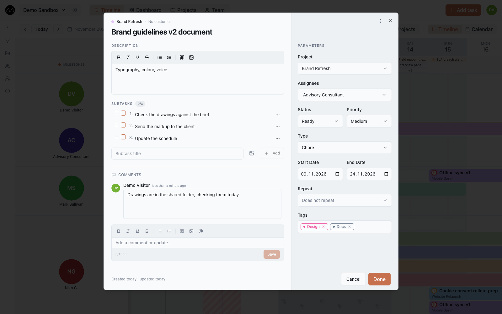

# Tasks

Click a bar on the timeline to open its task. The same card opens from the board, from
search, from a notification, and from the task lists on the **Team** and **Projects**
pages.

On the left are the title, the description, subtasks and comments. On the right,
**Parameters**. At the bottom, who created the task and who last changed its fields,
and when.

Click the **Updated** line to open the **Change history**: who moved the dates, changed
the status, the project or the assignees, renamed the task or edited the description,
and when. The five latest entries show first, the rest come with **Show more**. Several
quick edits of one field by the same person fold into a single entry. History is kept
for a year and starts when Motio was updated — earlier edits are not in it.

## Parameters

| Field | What it means |
|---|---|
| **Project** | the task's project; it gives the bar its colour. The project's customer is shown above the title. |
| **Assignees** | one person, several, or nobody (**Unassigned**). A task with several assignees appears in each of their rows. |
| **Status** | where the work stands. The list is the workspace's own; some statuses count as done, one as cancelled. |
| **Priority** | high, medium, low or none |
| **Type** | what kind of work it is: a task, a meeting, a review… The list is the workspace's own. |
| **Start date**, **End date** | the days the task takes. The end cannot be earlier than the start. |
| **Repeat** | see [Repeating tasks](#repeating-tasks) |
| **Tags** | free labels for filtering |

Statuses, task types and tags are set up by editors and admins in
[workspace settings → Workflow](./workspaces.md#workflow).

The **⋯** menu in the card's header has **Duplicate task** and **Delete task**.

## Description

The description is rich text: bold, italic, underline, strike-through, bulleted and
numbered lists, quotes, and pictures. Paste a screenshot, drag an image file in, or use
the image button (up to 5 MB per image). Text pasted from
other apps loses their fonts and colours, so it reads like the rest of Motio.

Click a picture to open it full screen and zoom in.

If someone else changed the description while you were writing yours, Motio does not
overwrite either version: it keeps your text and asks which one to keep —
**Keep mine** or **Show their version**.

## Subtasks

Subtasks are a checklist inside the task.

- Type a subtask and press **Enter** to add it; **Shift+Enter** starts a new line in the
  same subtask.
- A subtask you were typing is saved on its own when you leave the field or close the
  card. **Esc** throws it away.
- Tick it when it is done. Drag the **≡** handle to reorder.
- Each subtask can carry up to 10 pictures — handy for marking up a drawing or a
  screenshot. Pictures can be added while you are still creating the task.

## Comments

Comments are the task's conversation.

- Type **@** and a name to mention someone: they get a notification.
- Paste or insert pictures; a comment can be a picture alone.
- **⌘Enter** (**Ctrl+Enter** on Windows) sends the comment.
- Edit or delete your own comments from their **⋯** menu; an edited comment is marked
  *(edited)*.

Closing the card with a comment you haven't sent? Motio asks before throwing it away.
Viewers can read comments; editors and admins write them.

## Working on a task together

An open card stays live: subtasks and comments added by others appear as they are
added. On a computer you can also see what a teammate is typing right now — a subtask, a
comment, the description — shown semi-transparent with their name. This is on at
motio.nikog.net; on a company server the administrator decides.

## Repeating tasks

**Repeat** turns a task into a series: **Daily**, **Weekly**, **Biweekly (every 2
weeks)**, **Every 4 weeks**, **Monthly** or **Yearly**. Then choose when it stops:

| Repeat limit | Means |
|---|---|
| **Never** | repeats are created for the next 12 months |
| **Occurrences** | the number of repeats you set |
| **Until date** | repeats up to that date |

Every repeat is a task of its own on the timeline. When you change one of them, Motio
asks where the change applies:

- **Only this task** — this repeat only; it leaves the series.
- **This and following** — this one and everything after it.
- **All tasks** — the whole series.

Deleting works the same way: **Delete this** or **Delete this & following**; earlier
repeats always stay.

## Closing the card

- **Done** saves what you changed and closes the card.
- **Cancel** closes it and takes back the changes you made since you opened it — only
  yours, never your teammates'.
- **Esc** or clicking outside closes it too. If a title or description is not saved yet,
  or a comment is not sent, Motio asks first.

## Next

- [The board](./board.md): the same tasks by status.
- [Keyboard shortcuts](./shortcuts.md)
