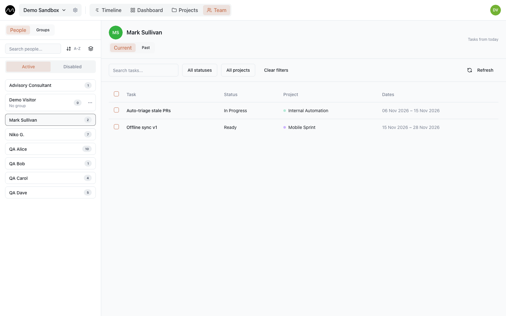

# Team

**Team** in the top bar lists the people of the workspace and its groups, and shows
each person's tasks in one place.

## People

The list on the left has every member, with their role and group. Search by name, sort
A–Z or Z–A, or tick **Group by group** to see departments together. **Disabled** people —
those an admin has switched off — are on their own tab; their tasks and history stay.

Pick a person to see their tasks:

- **Current** — tasks from today on; **Past** — earlier ones, with a date range if you
  need one.
- Search by title, filter by status or project, and sort by start date, end date or
  title.
- Click a task to open it with its subtasks and comments.

Editors and admins can tick several tasks and delete them at once.

Inviting people, roles and access are managed in
[workspace settings](./workspaces.md#members-and-access), not here.

## People without an account

Sometimes you want a person on the timeline before they use Motio, or you plan a
small team on your own. If the administrator of your Motio server has switched this on,
workspace admins see **Add person** on the Team page: type a name, and email and phone
if you like.

- The person gets a row on the timeline, like everyone else. You can give them tasks
  and time off, and they count in the workload heatmap.
- They cannot sign in and get no notifications. In the list they are marked
  **No account**, and the list of assignees in a task shows the same mark beside the
  name.
- **Edit**, **Disable** and **Enable** are in the person's menu. A disabled person
  moves to the **Disabled** tab with their tasks.
- People without an account cannot be put into a group.

When the person is ready to join, choose **Invite to Motio** in their menu and enter
their email and role. Once they accept, the row becomes theirs with every task and day
off already on it: nothing has to be moved by hand. If the invitation is cancelled, the
row stays as it was.

The same works for things that are not people: a van, a meeting room, a crew. Add a row
named **Van 2**, put its jobs on the timeline as tasks, and mark a repair as time off.
Motio treats it like a person, so it counts in the workload heatmap too.

## Groups

Groups are departments or disciplines — Design, Engineering, Support. A person is in one
group at a time. Use them to filter the timeline and the board by department.

Admins manage them on the **Groups** tab:

- **New group** creates one.
- **Add member** puts people into the selected group; **Move to another group** and
  **Remove from group** are in each person's menu.
- A group can be renamed or deleted. Deleting it keeps the people, just without a
  group; their tasks are not affected.
- Every group has a colour — the dot beside its name. Click the round swatch in front of
  the open group's name to pick one of twenty; **Automatic colour** hands the choice back
  to Motio, which gives the group a colour no other group has chosen. On a phone it is
  **Color** in the group's menu. The same dot marks the group as the owner team in the
  project list.

## Colours

Every person has a colour: behind their initials, on dashboard charts by person, and on
their time-off circles in the calendar. You can change your own in
**Workspace settings → Members and access → Colours**; admins can recolour anyone.

## Next

- [Projects and customers](./projects.md)
- [Workspace and roles](./workspaces.md)
