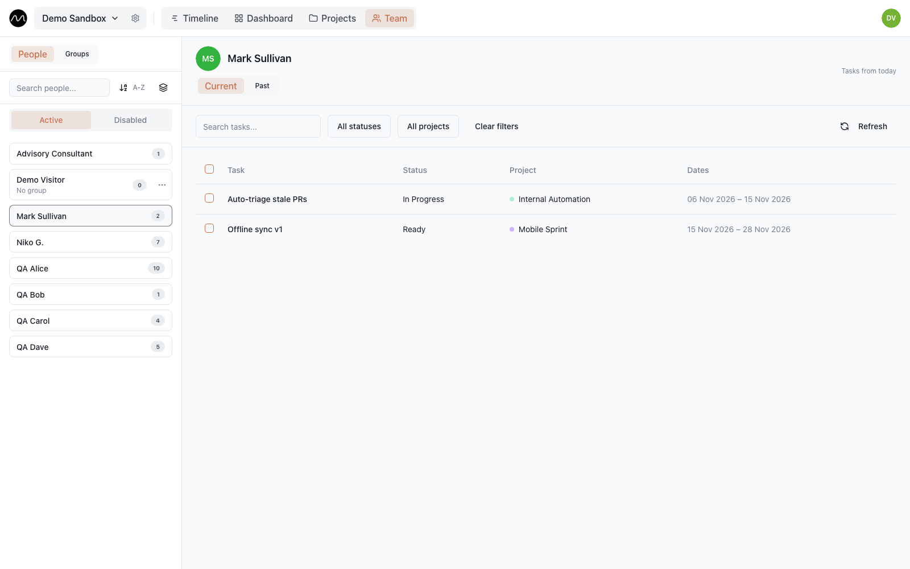

# Team

**Team** in the top bar lists the people of the workspace and its groups, and shows
each person's tasks in one place.

## People

The list on the left has every member, with their role and group. Search by name, sort
A–Z or Z–A, or tick **Group by group** to see departments together. **Disabled** people —
those an admin has switched off — are on their own tab; their tasks and history stay.

Pick a person to see their tasks:

- **Current** — tasks from today on; **Past** — earlier ones, with a date range if you
  need one.
- Search by title, filter by status or project, and sort by start date, end date or
  title.
- Click a task to open it with its subtasks and comments.

Editors and admins can tick several tasks and delete them at once.

Inviting people, roles and access are managed in
[workspace settings](./workspaces.md#members-and-access), not here.

## Groups

Groups are departments or disciplines — Design, Engineering, Support. A person is in one
group at a time. Use them to filter the timeline and the board by department.

Admins manage them on the **Groups** tab:

- **New group** creates one.
- **Add member** puts people into the selected group; **Move to another group** and
  **Remove from group** are in each person's menu.
- A group can be renamed or deleted. Deleting it keeps the people, just without a
  group; their tasks are not affected.

## Colours

Every person has a colour: behind their initials, on dashboard charts by person, and on
their time-off circles in the calendar. You can change your own in
**Workspace settings → Members and access → Colours**; admins can recolour anyone.

## Next

- [Projects and customers](./projects.md)
- [Workspace and roles](./workspaces.md)
