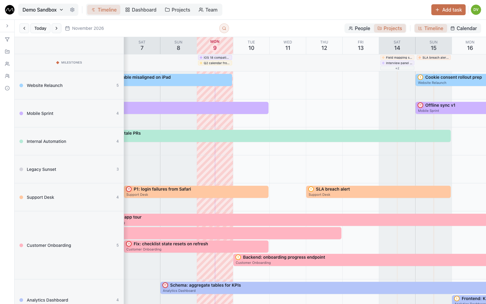
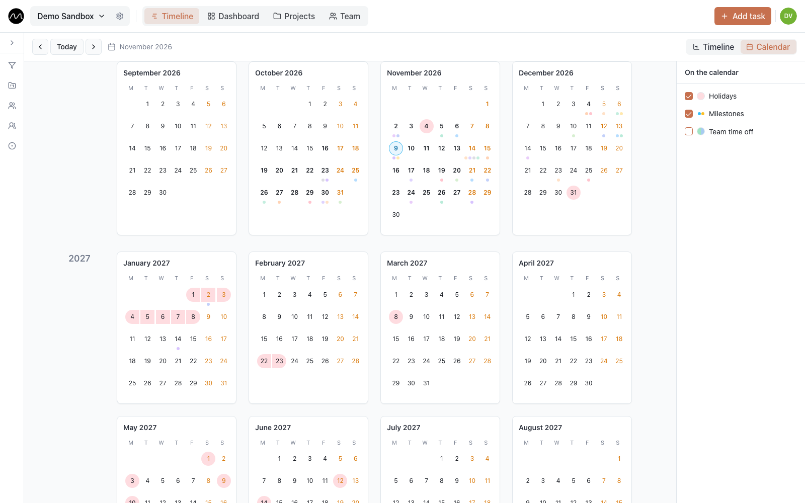

# The timeline

The timeline is Motio's main screen and the plan itself. Each row is a person (or a
project), each bar is a task, and its colour is the task's project. The column with red
stripes is today.

## Reading a bar

- **Colour** — the project.
- **Emoji** at the start — the task's status, if the status has one.
- **!** in green or amber, **‼** in red — low, medium or high priority.
- **Struck-through title** — the task is done. **Faded** — it was cancelled.
- **A grey Day off bar** — the person is away.

Tasks that overlap in time stack up inside the row, so a row three bars deep means three
things at once. Hover a bar for its project, assignees and repeat; click it to
[open the task](./tasks.md).

## Views

The toolbar above the timeline switches what you see:

| Switch | Options |
|---|---|
| **View** | **Timeline** · **Calendar** · **Board** (when [turned on](./board.md)) |
| **Rows** | **People** — one row per person · **Projects** — one row per project |
| **Scale** | **Day** · **Week** (when turned on in **Account settings → Appearance → Week view on the timeline**) |

**People** is where you plan: you see at a glance who is busy and who is free.
**Projects** is where you review: what is happening in each project and who is on it.
Archived projects are hidden in the **Projects** rows.

Move in time with **Previous**, **Today** and **Next**, or scroll sideways. Clicking a
person's avatar in their row shows a larger photo, their name and email. If an admin has
made the timeline denser ([workspace settings → Display](./workspaces.md#display), where
your server allows it), a small photo sits next to the name and rows are lower; phones
keep the usual layout.

## Add a task

- **Double-click an empty spot in a row.** The task form opens with that person (or
  project) and that day already filled in. Every row keeps some free space under its
  tasks for exactly this.
- **Right-click** a day in a row and choose **Create task** — the same thing.
- **Add task** in the top bar — an empty form.

Type a title, check the project and dates, and save. Everything else can wait: see
[Tasks](./tasks.md) for the full card.

## Move and stretch

- **Drag a bar** sideways to move its dates.
- **Drag its edge** to make it longer or shorter.

Dragging past the edge of the screen scrolls the timeline along. Dragging changes the
dates only: to hand a task to someone else, open it and change **Assignees**.

Everyone in the workspace sees the change within a second, without reloading.

### Undo

Moved, stretched or deleted something by mistake? **Undo** appears in the corner for a
few seconds, and **⌘Z** (**Ctrl+Z** on Windows) works too, up to the last 20 steps. Undo
brings back moves and resizes, status, priority or project changed from a bar's menu or
on the board, and deleted tasks. It never overwrites a newer change made by someone else.
Edits made inside the task card are not undone this way.

## The bar menu

Right-click a bar for quick changes without opening the task:

| Item | Does |
|---|---|
| **Status** | sets the status |
| **Priority** | high, medium, low or none |
| **Assign project** | moves the task to another project |
| **Duplicate task** | makes a copy |
| **Delete task** | deletes it (for a repeating task: only this one, or this and the following) |

When a task has several assignees and you work in the **People** rows, deleting from one
person's row offers to remove only that person from the task.

## Search

On a computer, press **⌘K** (**Ctrl+K** on Windows) or **/**, or click the magnifying
glass in the toolbar. Type at least two characters of a task or subtask title.

- Matching bars stay bright, everything else fades.
- The strip at the top shows matches on any date, not only the ones on screen. Move
  between them with **↑** and **↓** or by clicking; **Enter** opens the task.
- When a subtask matches, the preview shows its title and opens its task.
- **Esc** closes the search.

Search works in the **Day** and **Week** scales on a computer.

## Milestones

Milestones are the deadlines that matter: a delivery, a launch, a review. Each belongs
to a project and sits in the **Milestones** row above everyone's tasks, so the whole team
sees what it is working towards.

- **Add one:** double-click a day in the **Milestones** row, or double-click or
  right-click a date in the header and choose **Create milestone**.
- **Fill in** its name, date, project and an optional note.
- **Counts toward department workload** — leave it ticked for deliveries that keep people
  busy; untick it for a contract date or a reminder. It matters for the
  [workload heatmap](./dashboard.md#workload-heatmap).

Click a milestone to edit or delete it. When a day has many, **+N** shows the rest. All
milestones of all projects are also listed under **Projects → Milestones**.

## Time off

A plan that ignores vacations is a wish list.

1. Click **Add task** and switch to **Mark time off**.
2. Pick the person and the days, and add a note if you like ("Vacation", "Sick leave").
   The note is visible to the whole team.
3. Save.

Everyone can mark their own time off; admins can mark it for anyone. Time off shows as a
grey **Day off** bar, and the person's working days in it get a pattern (each person
picks theirs in **Account settings → Appearance → Time off pattern**). Click the bar to
change the days or remove it. The same days cannot be marked twice for one person.

Time off can also arrive from an HR or time-tracking system through the workspace API,
if your admin has set that up.

## Calendar

**View → Calendar** shows three whole years — last, this and next — month by month.

The panel on the right decides what is drawn:

- **Holidays** — non-working days of the workspace's country (and region, if one is
  picked in [workspace settings](./workspaces.md#general)), and the workspace's own
  **days off for everyone**, if an admin has added any.
- **Milestones** — coloured by project.
- **Team time off** — a circle on the day, split when several people are away. Pick
  people in the list, or **Only me**.

Double-click a day to open it on the timeline; right-click it and choose
**Create milestone** to add a milestone there. **Back to today** returns to the current
month.

## Filters

The funnel on the left edge of the timeline opens the filters: **Projects**, **People**,
**Groups**, **Status**, **Type** and **Tags**. Tick what you want to see; **Clear**
removes the filter. Archived projects and disabled people are not listed.

Filters help to walk a customer through their project only, or to look at one
department. Tasks without an assignee get a row of their own when you turn on
**Show unassigned** in [workspace settings → Display](./workspaces.md#display): it is your
own view setting and changes nothing for the others.

## Next

- [Tasks](./tasks.md): what is inside the task card.
- [Planning several projects with one team](./multiple-projects.md)
