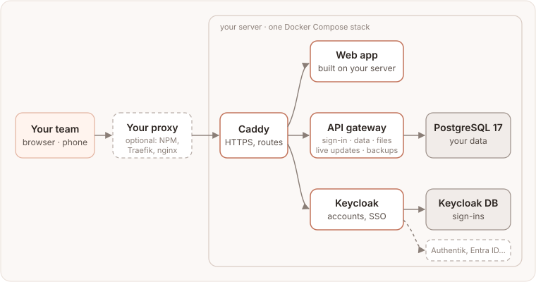

# Self-hosting Motio

Motio runs on your own server too: the same planner as the hosted version, under
your domain, with your company's sign-in if you like. One command installs it, one
command updates it, and every update can be rolled back.

Your data stays on your machine. A self-hosted Motio sends nothing to
motio.nikog.net: no analytics, no error reports. The only request leaving your
server is an optional check for new releases on GitHub (see [Settings](./settings.md)).

## How it fits together



- **One Docker Compose stack** on one Linux server: the web app, the Supabase
  services behind an API gateway (sign-in, data, live updates, files, backend
  functions), Keycloak for accounts and single sign-on, PostgreSQL, and a backup
  service.
- **Caddy in front** gets the HTTPS certificate itself, or sits behind the reverse
  proxy you already run (Nginx Proxy Manager, Traefik, nginx…).
- **Keycloak** keeps the accounts. It can also hand sign-in over to your company's
  identity provider: Authentik, Microsoft Entra ID, Google Workspace.
- **The installer** (`infra/scripts/install.sh`) does the rest: generates every
  secret, starts the stack in the right order, takes a full backup before each
  update and can roll back.

## Quick start

On a Linux server with Docker and a domain pointing at it:

```bash
git clone https://github.com/eleron96/motio.git && cd motio
git checkout vX.Y.Z    # the latest release: github.com/eleron96/motio/releases
infra/scripts/install.sh --domain planner.example.com --email you@example.com
```

About 15 minutes later Motio answers at `https://planner.example.com`. Behind your
own reverse proxy, add `--mode proxy` (see [Install](./install.md)).

## The guide

**Get started**
- [Requirements](./requirements.md): the server, the domain, what is optional.
- [Install](./install.md): the two modes, what the installer does, the first sign-in.
- [Reverse proxy](./reverse-proxy.md): Nginx Proxy Manager, Traefik, nginx, or no Caddy at all.

**Set it up**
- [Administrators](./admins.md): super admins, admins from a group, Keycloak's own admin.
- [People and workspaces](./people.md): invitations with or without email, adding people directly, workspaces from groups.
- [Your own sign-in](./sign-in.md): Authentik, Entra ID, Google Workspace through Keycloak.
- [Email](./email.md): what changes once Motio can send mail.
- [Settings](./settings.md): the settings you are most likely to change.

**Keep it running**
- [Updates and rollback](./updates.md): updating, which versions exist, going back.
- [Backups and restore](./backups.md): nightly backups, full backup sets, moving to another server.
- [Day to day](./running.md): status, logs, the admin console (System, activity log, user card, invitations), Portainer, WUD, Beszel.
- [Security](./security.md): how images are chosen, the weekly scan, staying informed.

**Help**
- [Troubleshooting](./troubleshooting.md): error messages and what to do about them.
- [FAQ and limits](./faq.md): short answers, and what self-hosting does not do yet.

## Getting help

Self-hosting is community-supported.
- Questions: [Discussions → Q&A](https://github.com/eleron96/motio/discussions/categories/q-a).
- Bugs: [open an issue](https://github.com/eleron96/motio/issues/new/choose); `install.sh status` output and the support report from **Admin → System** help.
- Vulnerabilities: privately, as described in [SECURITY.md](https://github.com/eleron96/motio/blob/main/SECURITY.md).
