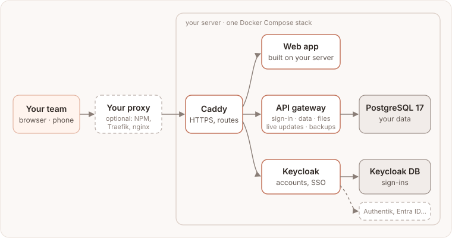

# Motio на своём сервере

Motio работает и на вашем сервере: тот же планировщик, что в облачной версии, на
вашем домене и, если хотите, со входом вашей компании. Одна команда его ставит,
одна — обновляет, и любое обновление можно откатить.

Ваши данные остаются на вашей машине. Motio на своём сервере ничего не отправляет
на motio.nikog.net: ни аналитики, ни отчётов об ошибках. Единственный запрос
наружу — необязательная проверка новых релизов на GitHub (см. [Настройки](./settings.md)).

## Как всё устроено



- **Один стек Docker Compose** на одном сервере с Linux: веб-приложение, сервисы
  Supabase за шлюзом API (вход, данные, живые обновления, файлы, серверные
  функции), Keycloak для учётных записей и единого входа, PostgreSQL и сервис
  бэкапов.
- **Caddy на входе** сам получает сертификат HTTPS — или стоит за обратным прокси,
  который у вас уже есть (Nginx Proxy Manager, Traefik, nginx…).
- **Keycloak** хранит учётные записи. Он же может передать вход провайдеру вашей
  компании: Authentik, Microsoft Entra ID, Google Workspace.
- **Установщик** (`infra/scripts/install.sh`) делает остальное: создаёт все
  секреты, запускает стек в нужном порядке, перед каждым обновлением снимает
  полную копию и умеет откатываться.

## Быстрый старт

На сервере с Linux, Docker и доменом, который на него указывает:

```bash
git clone https://github.com/eleron96/motio.git && cd motio
git checkout vX.Y.Z    # последний релиз: github.com/eleron96/motio/releases
infra/scripts/install.sh --domain planner.example.com --email you@example.com
```

Минут через 15 Motio отвечает по адресу `https://planner.example.com`. Если перед
ним стоит ваш обратный прокси, добавьте `--mode proxy` (см. [Установку](./install.md)).

## Содержание

**Начало**
- [Требования](./requirements.md): сервер, домен и что необязательно.
- [Установка](./install.md): два режима, что делает установщик, первый вход.
- [Обратный прокси](./reverse-proxy.md): Nginx Proxy Manager, Traefik, nginx или вовсе без Caddy.

**Настройка**
- [Администраторы](./admins.md): суперадмины, админы по группе, администратор самого Keycloak.
- [Люди и пространства](./people.md): приглашения с почтой и без, добавление людей напрямую, пространства по группам.
- [Свой вход](./sign-in.md): Authentik, Entra ID, Google Workspace через Keycloak.
- [Почта](./email.md): что меняется, когда Motio может отправлять письма.
- [Настройки](./settings.md): то, что вы скорее всего захотите поменять.

**Эксплуатация**
- [Обновления и откат](./updates.md): как обновляться, какие версии бывают, как вернуться.
- [Бэкапы и восстановление](./backups.md): ночные бэкапы, полные копии, переезд на другой сервер.
- [Повседневное](./running.md): состояние, логи, админ-консоль (Система, журнал, карточка пользователя, приглашения), Portainer, WUD, Beszel.
- [Безопасность](./security.md): как выбираются образы, еженедельная проверка, как узнавать о новом.

**Помощь**
- [Решение проблем](./troubleshooting.md): сообщения об ошибках и что с ними делать.
- [Вопросы и ограничения](./faq.md): короткие ответы и чего своя установка пока не умеет.

## Где получить помощь

Свои установки поддерживает сообщество.
- Вопросы: [Discussions → Q&A](https://github.com/eleron96/motio/discussions/categories/q-a).
- Ошибки: [создайте issue](https://github.com/eleron96/motio/issues/new/choose); помогут вывод `install.sh status` и отчёт для поддержки из раздела **Админ-консоль → Система**.
- Уязвимости: приватно, как описано в [SECURITY.md](https://github.com/eleron96/motio/blob/main/SECURITY.md).
